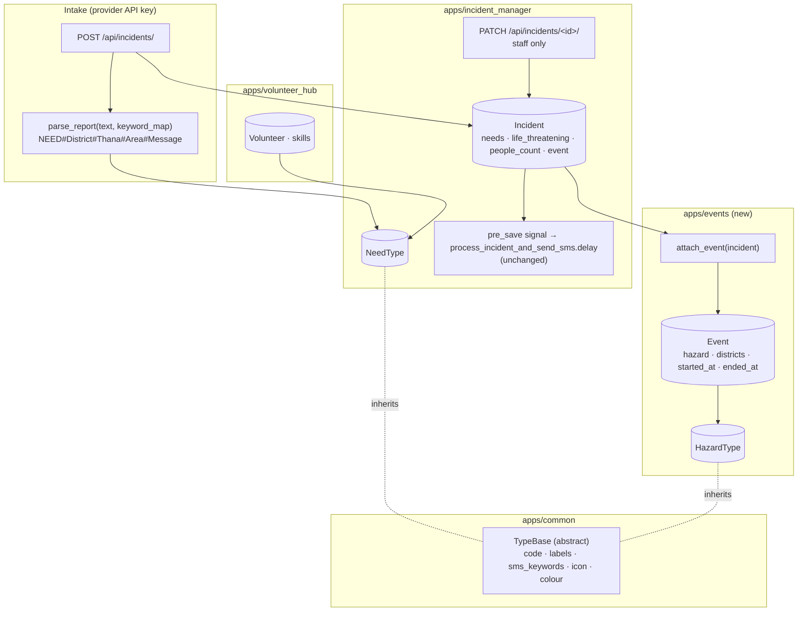
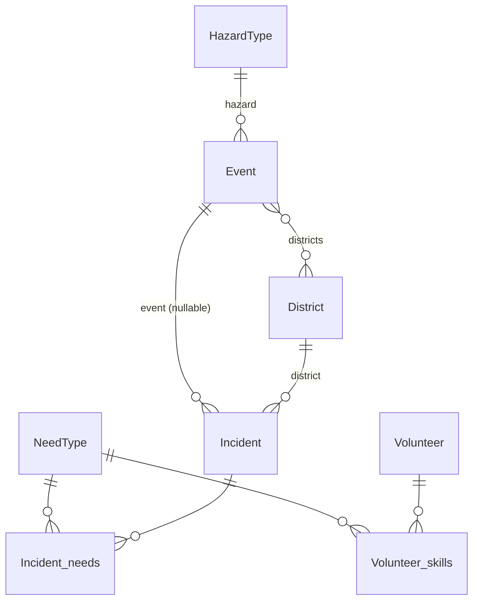

# Specification: Hazard-agnostic incident types: needs, hazards and events

**Status:** Implemented and tested (2026-11-04): 110 Django + 30 JS tests passing
**Branch:** `feat/hazard-agnostic-incident-types` · **Delivery:** one PR, one green commit per task group

## Executive Summary

Give every incident a structured **need type** (what help is needed) and let operators group
incidents into **events** that carry the **hazard** (what is happening). Both lists are
admin-editable tables seeded with a proposed set, so the platform handles floods, cyclones, fires
or epidemics without code changes. Reporters add one keyword to their SMS (`RESCUE#…` or
`UDDHAR#…`), and volunteers pick skills from the same need list. Operators (staff accounts) get one
write endpoint to validate and classify incidents.

The same PR closes a data exposure: any self-registered account can currently read reporters'
phone numbers through the incident list. Incident data and operator actions become staff-only.

---

## Problem Statement

**Current State:**
- `Incident` has free-text `description` and an unstructured `additional_info` JSON; nothing
  says what kind of help is needed.
- The SMS parser (`smsparser/pharser.py`) expects `District#Thana#Area#Message` with no
  category, and isn't connected to Django.
- `Volunteer.assistance_type` is free text, so values don't match each other or anything on the
  incident side.
- There is no notion of an event, so the system is implicitly flood-only.
- `GET /api/incidents/list/` returns contact numbers to **any** signed-in account, and anyone can
  sign up.
- Operators can only validate or reject in the Django admin.

**Desired State:**
- Incidents have one or more need types, a life-threatening flag, a people count and an optional
  event.
- Events (hazard, districts, active period) are managed by operators; new incidents attach
  automatically.
- Volunteers declare skills from the need list.
- Incident data and operator actions require staff; operators validate and classify through
  one API.

**Impact:**
- Triage and filtering become possible; matching (#41) has shared categories; new hazards need no
  deploy; reporters' personal data is no longer exposed to arbitrary accounts.

---

## Goals & Success Criteria

### Primary Goals
1. Staff-only incident data, plus an operator `PATCH` for status, needs, triage and event.
2. Shared, admin-managed need and hazard type lists, seeded with the proposal.
3. Needs captured at intake from SMS keywords or explicit fields, never rejecting a report.
4. Events grouping incidents by hazard, districts and time, with auto-attach.
5. Volunteer skills from the need list, with existing data migrated.

### Success Criteria
- [ ] Every acceptance criterion in `planning/requirements.md` is covered by a test written
      before its implementation.
- [ ] Providers posting without `needs` keep getting `201`.
- [ ] The incident list stays at a constant number of queries for 1 vs 20 incidents.
- [ ] Non-staff accounts get `403` on incident data and operator actions; the dashboard tells
      them their account isn't an operator yet.
- [ ] Each commit on the branch passes `docker compose run --rm unit_tests` and `npm test`.

### Non-Goals
- SMS gateway webhook, dashboard UI for types (chips, icons, editing in the drawer), volunteer
  matching and dispatch, free-text classification, custom event polygons, removing
  `assistance_type` (later cleanup).

---

## Architecture Overview



---

## Technical Design

### Shared base (`apps/common/models.py`)
- `TypeBase` (abstract):
  - `code` (SlugField, unique), `label_en`, `label_bn`;
  - `sms_keywords` (`ArrayField(CharField(max_length=40))`, saved lowercased and stripped in
    `save()`);
  - `icon` (Bootstrap Icons name), `colour` (`#RRGGBB`, validated), `sort_order`, `is_active`.
  - Ordered by `sort_order`, `label_en`; `__str__` returns `label_en`.

### `apps/incident_manager`
- **`models/types.py`:** `NeedType(TypeBase)` with `is_fallback` and a `UniqueConstraint`
  allowing only one row with `is_fallback=True`. Class method `fallback()` returns the `other`
  row, and `keyword_map()` returns `{keyword: code}` for active rows.
- **`models/incident.py`:**
  - new fields: `needs` (M2M NeedType, `related_name="incidents"`), `life_threatening` (bool,
    default False, `db_index=True`), `people_count` (PositiveIntegerField, null/blank), `event`
    (FK `"events.Event"`, SET_NULL, null/blank, `related_name="incidents"`);
  - fix `__str__`, which references a non-existent `status` field.
- **`services/report_parser.py`:** pure function `parse_report(text, keyword_map)` returning
  `ParsedReport(need_codes, district, thana, area, message)`:
  - It splits on `#` with `maxsplit=4`, so a `#` inside the message is kept.
  - If the first segment's tokens (split on `+` or `,`) are all known keywords, they become the
    needs and the remaining four parts are location and message.
  - Otherwise it uses the legacy 4-part form, or treats the whole text as the message, with
    needs `["other"]`.
  - Input is truncated to 2,000 characters before parsing.
- **Serializers:**
  - `IncidentSerializer` (provider create) adds `needs` (`SlugRelatedField(slug_field="code",
    many=True, required=False, queryset=NeedType.objects.filter(is_active=True))`),
    `life_threatening` and `people_count`.
  - In `create()`: if `needs` is absent, it parses `description` with `parse_report`. It then
    sets the needs and calls `attach_event`.
  - *(Added during execution.)* Providers send no district, so `create()` also sets `district`
    and `thana` from the parsed report when the names match existing ones, ignoring case.
    Without this, auto-attach could never fire at intake. Fuzzy spell correction (the standalone
    `smsparser` models) stays out of scope.
  - `IncidentListSerializer` adds `needs` (codes), `life_threatening`, `people_count`, and
    `event` (`{id, name}` or null).
  - `IncidentOperatorSerializer` (PATCH) has writable `validation_status` (choices),
    `task_status`, `needs` (at least one), `life_threatening`, `people_count` and `event`
    (PrimaryKeyRelatedField). It responds with the list shape.
- **Views:**
  - `IncidentListView`: permission `IsAdminUser`; `select_related("event")` and
    `prefetch_related("needs")`.
  - `IncidentDetailView` (new): `PATCH` only, `IsAdminUser`, 404 for unknown ids. It saves
    through the model instance, so the existing `pre_save` signal still queues the SMS task when
    the status becomes validated.
  - `NeedTypeListView` (new): `IsAdminUser`, active need types.
- **URLs:** `list/` (existing), `<int:pk>/` (PATCH), `need-types/`.
- **Admin:** `NeedTypeAdmin` (list_editable `sort_order` and `is_active`); `IncidentAdmin` gets
  `filter_horizontal = ["needs"]`, the triage fields and event.

### `apps/events` (new app)
- **`models.py`:**
  - `HazardType(TypeBase)` with `group` (TextChoices: `water_weather`, `geological`,
    `fire_structural`, `transport`, `biological`, `other`).
  - `Event`: `name`, `hazard` (FK, PROTECT), `districts` (M2M `incident_manager.District`),
    `started_at` (default `timezone.now`), `ended_at` (null), `notes` (blank), timestamps.
  - `EventQuerySet.active(at=None)` returns events with `started_at <= at` and either
    `ended_at` null or later than `at`.
- **`services.py`:** `attach_event(incident)` returns the newest active event whose districts
  include `incident.district`, or None. The caller saves it.
- **API:** `EventListView` at `GET /api/events/` (`IsAdminUser`), with `?active=true` filter.
  Response: id, name, hazard (code, labels, icon, colour), `started_at`, `ended_at`,
  `district_ids`.
- **Admin:** `HazardTypeAdmin`; `EventAdmin` with `filter_horizontal` districts and list filters
  by hazard and active.
- **URLs:** `config/urls.py` adds `path("api/events/", include("apps.events.urls"))`.

### `apps/volunteer_hub`
- `Volunteer.skills` (M2M `incident_manager.NeedType`, blank). `assistance_type` stays, with
  `help_text="Deprecated: use skills"` and no longer required (`blank=True`, default `""`).
- `VolunteerSerializer` adds `skills` (codes). The volunteer list stays public, as now.

### `apps/webui` (small, required by the access change)
- `api.js` passes a 403 through as `{ok: false, status: 403}`, as it already does for other
  errors. `dashboard.js` and `incidents.js` show "Your account isn't an operator yet. Ask an
  administrator to give you operator access." instead of an empty map or table.

### Celery
- No new tasks. `process_incident_and_send_sms` and the `pre_save` signal are unchanged; the
  PATCH path must still trigger it (tested).

---

## Data Model Changes



**Migrations, in dependency order** (the apps reference each other, so the order matters):

| # | App | Migration | Contents |
|---|---|---|---|
| 1 | incident_manager | `0008_needtype_incident_triage` | NeedType; Incident `needs`, `life_threatening`, `people_count` |
| 2 | incident_manager | `0009_seed_need_types` | Data: seed need types (idempotent `update_or_create`, labels not overwritten if edited) and give existing incidents `other` |
| 3 | events | `0001_initial` | HazardType, Event (depends on incident_manager 0008 for District) |
| 4 | events | `0002_seed_hazard_types` | Data: seed hazard types |
| 5 | incident_manager | `0010_incident_event` | Incident `event` FK (depends on events 0001) |
| 6 | volunteer_hub | `0006_volunteer_skills` | `skills` M2M; `assistance_type` blank/default; data: map values to skills, append unmapped to notes |

Each data migration has a reverse that deletes only the rows it created.

**Seed: need types**

| code | label_en | label_bn | sms_keywords | icon | colour |
|---|---|---|---|---|---|
| rescue | Rescue | উদ্ধার | rescue, uddhar, uddhaar, udhar, উদ্ধার | `life-preserver` | `#DC2626` |
| medical | Medical | চিকিৎসা | medical, medicine, oshudh, osudh, oshud, ওষুধ, চিকিৎসা | `heart-pulse` | `#DB2777` |
| food | Food | খাবার | food, khabar, khaddo, খাবার | `basket` | `#D97706` |
| water | Water & sanitation | পানি ও স্যানিটেশন | water, pani, পানি | `droplet` | `#0284C7` |
| shelter | Shelter | আশ্রয় | shelter, ashroy, asroy, আশ্রয় | `house` | `#7C3AED` |
| missing | Missing person | নিখোঁজ | missing, nikhoj, nikhoz, নিখোঁজ | `person-exclamation` | `#0F766E` |
| safety | Safety | নিরাপত্তা | safety, nirapotta, নিরাপত্তা | `shield-exclamation` | `#B45309` |
| damage | Damage report | ক্ষতির খবর | damage, khoti, ক্ষতি | `cone-striped` | `#475569` |
| other | Other | অন্যান্য | (none; `is_fallback=True`) | `question-circle` | `#64748B` |

**Seed: hazard types** (group → codes; Bangla labels in the migration):
- water & weather → flood, flash_flood, waterlogging, cyclone, storm, lightning, heatwave,
  cold_wave, drought;
- geological → earthquake, landslide, river_erosion, tsunami;
- fire & structural → fire, building_collapse, industrial_accident, explosion;
- transport → road_accident, boat_capsize;
- biological → epidemic;
- other → other.

**`assistance_type` → skills mapping:**
- food → food;
- doctor, medical, medicine, nurse → medical;
- boat, rescue, swimmer → rescue;
- water → water;
- shelter, transport → shelter;
- anything else is appended to notes as `Previous assistance type: <value>`.

---

## API Specification

| Method | Path | Auth | Change |
|---|---|---|---|
| POST | `/api/incidents/` | Provider API key | Accepts `needs`, `life_threatening`, `people_count`; parses needs from text if absent; auto-attaches event |
| GET | `/api/incidents/list/` | **Staff** (was: any signed-in) | Adds `needs`, `life_threatening`, `people_count`, `event` |
| PATCH | `/api/incidents/<id>/` | Staff | **New.** Any of `validation_status`, `task_status`, `needs`, `life_threatening`, `people_count`, `event` |
| GET | `/api/incidents/need-types/` | Staff | **New.** Active need types |
| GET | `/api/events/?active=true` | Staff | **New.** Events with hazard |
| GET | `/api/volunteers/volunteers/` | Public (unchanged) | Adds `skills` |

**PATCH /api/incidents/42/**
```json
{ "validation_status": "validated", "needs": ["rescue", "medical"], "life_threatening": true, "people_count": 5 }
```
- `200` returns the incident in list shape.
- `400` for an unknown need code, an empty `needs` list, a bad status or an unknown event.
- `401` when not signed in, `403` when not staff, `404` for an unknown incident.

**POST /api/incidents/**: new optional fields as above. `400 {"needs": [...]}` for unknown or
inactive codes.

**GET /api/incidents/need-types/**
```json
[{ "code": "rescue", "label_en": "Rescue", "label_bn": "উদ্ধার", "icon": "life-preserver", "colour": "#DC2626" }]
```

**GET /api/events/?active=true**
```json
[{ "id": 3, "name": "Feni Flood, Aug 2027",
   "hazard": { "code": "flood", "label_en": "Flood", "label_bn": "বন্যা", "icon": "water", "colour": "#0284C7" },
   "started_at": "2027-08-20T06:00:00Z", "ended_at": null, "district_ids": [12, 15] }]
```

---

## Testing Strategy

All tests are written **before** the code they cover, watched failing for the expected reason,
then made to pass (`tdd` skill). Run backend tests with
`docker compose exec be python manage.py test apps.<app>` and the full suite with
`docker compose run --rm unit_tests`. JS tests use `npm test`. External calls (Celery `.delay`)
are patched.

### Unit tests
**`report_parser`** (`apps/incident_manager/tests/test_report_parser.py`, no DB; `SimpleTestCase`):
- A report starting with a known keyword gets that need and the location parts.
- Several keywords joined by plus or comma give every matching need.
- Keywords match regardless of case and surrounding spaces.
- Banglish and Bangla-script keywords match the same need as the English keyword.
- An unknown keyword gives the Other need and keeps the whole text as the message.
- The old four-part format without a keyword still parses its location and gives Other.
- A hash sign inside the message is kept as part of the message.
- Empty text gives Other and an empty message.
- Text longer than 2,000 characters is truncated before parsing.

**Models:**
- Only one need type can be the fallback.
- Keywords are stored lowercased and stripped.
- The keyword map includes only active need types.
- An active event has started and not ended (`Event.objects.active()` excludes ended and future
  events).
- An incident's string representation names its id and validation status (regression for the
  `status` bug).

**`attach_event`** (`apps/events/tests/test_services.py`):
- An incident in a district covered by an active event is attached to it.
- Ended and not-yet-started events are ignored.
- When several active events cover the district, the most recently started one wins.
- An incident without a district is not attached to any event.

**Seed migrations:**
- The seeded need types include every proposed code and exactly one fallback.
- The seeded hazard types cover every proposed group.
- Running the need-type seed again doesn't create duplicates or overwrite edited labels.
- Existing volunteer assistance types map to skills, and unmapped values are kept in notes
  (call the migration function directly).

### Integration tests (API)
**Operator access** (`test_list_incidents.py`, extends the stashed tests):
- Anonymous requests to the incident list are refused with 401.
- Signed-in accounts that are not operators are refused with 403.
- Operators see incidents newest first with coordinates, needs, triage fields and event.
- Listing incidents uses the same number of queries for one or twenty incidents.

**Operator PATCH** (`test_operator_update.py`):
- An operator validates an incident and the SMS task is queued.
- An operator rejects an incident and no SMS task is queued.
- An operator reclassifies needs and sets triage fields in the same request as validating.
- An unknown need code, an empty needs list or an unknown status is refused with 400 and nothing
  changes.
- An operator can attach an incident to an event.
- Non-operators cannot update incidents (403); a missing incident returns 404.

**Provider intake** (`test_create_incidents.py`, extended):
- A provider can send explicit needs and triage fields.
- Needs are parsed from the report text when the provider sends none.
- A report without a recognised keyword is accepted with the Other need.
- An unknown need code from a provider is refused with 400.
- A new incident in a district with an active event is attached to that event.
- The district and thana named in a report are set on the incident when they match known ones, ignoring case.
- An unknown district name leaves the incident without a district.
- The existing provider payload without the new fields is still accepted (regression).

**Lookups:**
- Operators get active need types with both labels, icon and colour; inactive ones are hidden.
- The events list with `active=true` returns only active events with their hazard; non-operators
  get 403.
- The volunteer list includes each volunteer's skills.

### JS tests (Vitest)
- A 403 from the API is returned to the page as not allowed, without ending the session (unlike
  401).
- `dashboard.js` and `incidents.js` show the operator-access message; their rendering helper is
  tested in `tables.test.js`.

### E2E (manual check before PR, headless Chrome)
- A staff user sees the map and list. A non-staff user sees the operator-access message on both
  pages.

### Test files
- `apps/incident_manager/tests/`:
  - `test_report_parser.py` (parser);
  - `test_need_types.py` (model and lookup);
  - `test_seed_need_types.py` (seed and backfill);
  - `test_incident_fields.py` (triage, `__str__`);
  - `test_list_incidents.py` (access, fields, query counts);
  - `test_operator_update.py` (PATCH);
  - `test_create_incidents.py` (intake: needs, district and thana, event).
- `apps/events/tests/`:
  - `test_models.py` (active events, hazard seed);
  - `test_services.py` (`attach_event`);
  - `test_api.py` (events list);
  - `factories.py`.
- `apps/volunteer_hub/tests/`:
  - `test_get_volunteer.py` (skills, query count);
  - `test_skills_migration.py`.
- `apps/webui/static/webui/js/`: `api.test.js` (403), `tables.test.js` (operator notice).

### Results
- 110 Django tests and 30 JS tests pass (`/run-tests`, 2026-11-04).
- No coverage tool is installed. Instead, the query-count and 403 guards were each checked by
  breaking the code on purpose and watching the test fail.

### Mapping to acceptance criteria
Each criterion in `planning/requirements.md` is covered by the tests above: keywords → parser
and intake tests; events → `attach_event` and intake tests; list fields and query count → list
tests; volunteers → migration and list tests; lookups → lookup tests; existing incidents → seed
test.

---

## Migration Plan

### Phase 1 (this PR)
Apply migrations 1–6. Existing incidents get `other`, volunteers keep `assistance_type` and
gain skills. In each environment, give operators `is_staff`; locally, set it on the dev
accounts.

### Phase 2 (follow-up features)
- Dashboard: need chips, icons, drawer editing via the PATCH endpoint.
- SMS gateway webhook using `parse_report`.
- Matching (#41).

### Phase 3 (cleanup)
Remove `Volunteer.assistance_type`.

---

## Security Considerations

- Incident data (phone numbers, locations) and all operator writes require `is_staff`. This
  closes the current exposure to self-registered accounts.
- Lookups expose no personal data and still require staff, for consistency.
- The volunteer list stays public as today; review separately, since it shows names and
  addresses.
- Report text is stored as-is and rendered only through `escapeHtml`. The parser does plain
  string splitting on bounded input, with no regex built from input.
- PATCH validates every field through the serializer. Status changes go through
  `instance.save()`, never `QuerySet.update()`, so the signal and audit trail aren't bypassed.

---

## Performance Considerations

- `select_related("event")` and `prefetch_related("needs")` on list and PATCH responses, guarded
  by an `assertNumQueries` test.
- The keyword map is built once per create request from a few dozen rows.
- `attach_event` makes one query per new incident.
- `life_threatening` is indexed for future filters.

---

## Summary

One PR, one green commit per task group (see `tasks.md`):
1. Operator-only access, the PATCH endpoint and the web UI's operator-access message, in one
   commit so the app stays usable.
2. Need types and incident triage fields.
3. The report parser and provider intake.
4. Events and hazards with auto-attach.
5. Volunteer skills.
6. Verification and docs.

The platform gets hazard-agnostic categories that the dashboard, SMS gateway and matching build
on next, and reporters' data stops being visible to every account.
