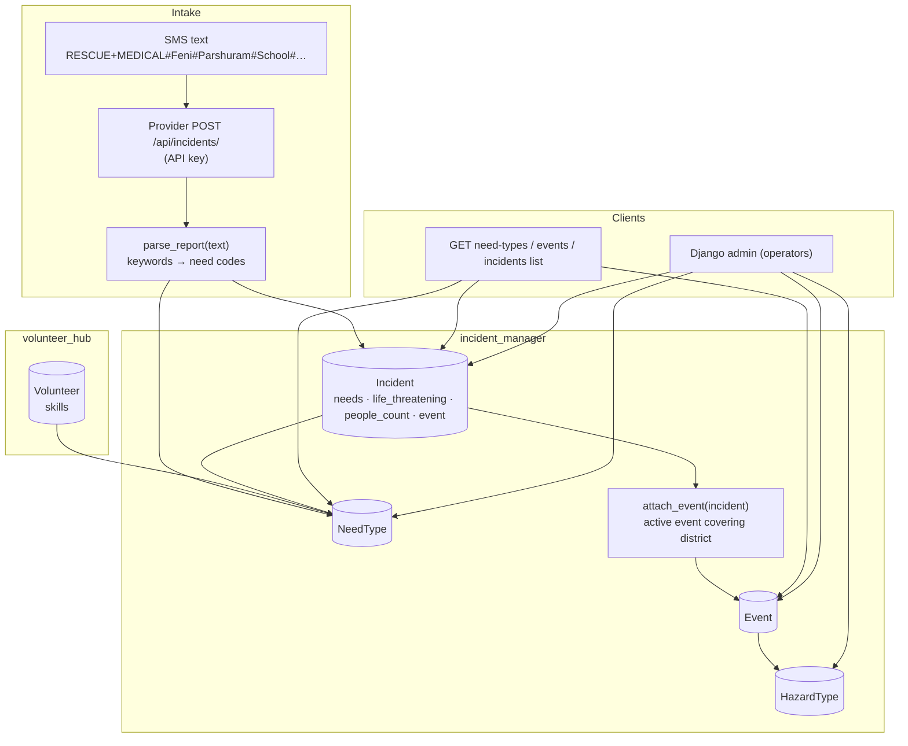
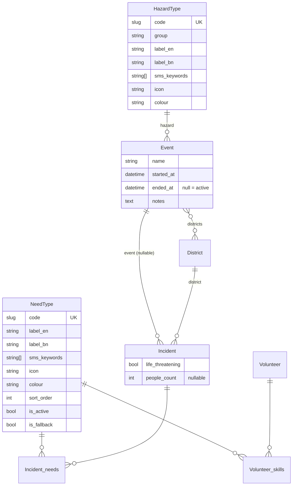

# Specification: Hazard-agnostic incident types: needs, hazards and events

## Executive Summary

Give every incident a structured **need type** (what help is needed) and let operators group
incidents into **events** that carry the **hazard** (what is happening). Both lists are
admin-editable tables seeded with a proposed set, so the platform handles floods, cyclones, fires
or epidemics without code changes. Reporters add one keyword to their SMS (`RESCUE#…` or
`UDDHAR#…`), volunteers pick skills from the same need list, and the dashboard, matching (#41)
and the SMS gateway can all build on these shared categories.

---

## Problem Statement

**Current State:**
- `Incident` has free-text `description` and an unstructured `additional_info` JSON; nothing
  says what kind of help is needed.
- The SMS parser (`smsparser/pharser.py`) expects `District#Thana#Area#Message` with no
  category, and isn't connected to Django.
- `Volunteer.assistance_type` is free text, so values don't match each other or anything on the
  incident side.
- There is no notion of an emergency or event, so the system is implicitly flood-only.

**Desired State:**
- Each incident has one or more need types, a life-threatening flag and a people count.
- Incidents belong to an operator-activated event that names the hazard.
- Volunteers declare skills from the same need list.
- Types, keywords and hazards are managed in the admin.

**Impact:**
- Operators can triage and filter; matching becomes possible; new hazards need no deploy.

---

## Goals & Success Criteria

### Primary Goals
1. Shared, admin-managed need and hazard type lists, seeded with the proposal.
2. Needs and triage fields captured at intake from SMS keywords or explicit API fields, never
   rejecting a report for a bad keyword.
3. Events that group incidents by hazard, area (districts) and time, with auto-attach.
4. Volunteer skills drawn from the need list, with existing data migrated.

### Success Criteria
- [ ] All acceptance criteria in `planning/requirements.md` pass as automated tests.
- [ ] Existing providers keep working without sending `needs`.
- [ ] The incident list stays at a constant query count with needs and events.

### Non-Goals
- SMS gateway webhook, dashboard UI for types, volunteer matching/dispatch, free-text
  classification, custom event polygons (see Out of Scope in requirements).

---

## Architecture Overview

### High-Level System Architecture



---

## Technical Design

### Django Backend

**Models** (`apps/incident_manager/models/`):
- `types.py`:
  - `TypeBase` (abstract): `code` (SlugField, unique), `label_en`, `label_bn`, `sms_keywords`
    (`ArrayField(CharField)`, stored lowercased), `icon` (Bootstrap Icons name), `colour` (hex),
    `sort_order`, `is_active`. Ordered by `sort_order`, `label_en`.
  - `NeedType(TypeBase)` adds `is_fallback` (DB constraint: at most one True).
  - `HazardType(TypeBase)` adds `group` (choices: `water_weather`, `geological`,
    `fire_structural`, `transport`, `biological`, `other`).
- `event.py`: `Event` with `name`, `hazard` (FK HazardType, PROTECT), `districts` (M2M District),
  `started_at` (default now), `ended_at` (nullable), `notes`, timestamps. `is_active` property;
  `Event.objects.active()` queryset method (`ended_at__isnull=True`, `started_at <= now`).
- `incident.py`: add `needs` (M2M NeedType, `related_name="incidents"`), `life_threatening`
  (bool, default False, indexed), `people_count` (PositiveIntegerField, null), `event` (FK Event,
  SET_NULL, null). Also fix the existing `__str__`, which references a non-existent `status`
  field.

**Services** (`apps/incident_manager/services/`):
- `report_parser.py`:
  - `parse_report(text, keyword_map) -> ParsedReport(needs, district, thana, area, message)`.
    Pure function, no DB.
  - `keyword_map` is built once per call from active NeedTypes: `{keyword: code}`.
  - Handles the 5-part and legacy 4-part formats, multiple keywords (`,` or `+`), case and
    whitespace, and returns `["other"]` when nothing matches.
- `events.py`: `attach_event(incident)` picks the newest active event whose districts include
  `incident.district`. Called from `IncidentSerializer.create` after saving, not from a signal,
  so it's explicit and easy to test.

**Views / APIs** (`apps/incident_manager/apis.py`):
- `IncidentCreateView` (existing): serializer accepts `needs` (list of codes via
  `SlugRelatedField(slug_field="code", many=True, queryset=active NeedTypes)`),
  `life_threatening`, `people_count`. If `needs` is missing, parse `description`. Then
  `attach_event`.
- `IncidentListView` (existing): adds `needs`, `life_threatening`, `people_count`, and `event`
  (`{id, name}`), with `prefetch_related("needs")` and `select_related("event")`.
- `NeedTypeListView` (new, signed-in): active need types.
- `EventListView` (new, signed-in): events; `?active=true` filters to active ones, including
  hazard code and labels.

**URLs** (`apps/incident_manager/urls.py`): `need-types/`, `events/`.

**Admin**:
- `NeedTypeAdmin` and `HazardTypeAdmin`: list editable `sort_order` and `is_active`, search by
  code and labels.
- `EventAdmin`: `filter_horizontal` districts, list filter by hazard and active.
- `IncidentAdmin`: `filter_horizontal` needs, triage fields, event.

**Volunteers** (`apps/volunteer_hub`):
- `Volunteer.skills` (M2M NeedType); serializer adds `skills` (codes).
- `assistance_type` is kept, marked deprecated in `help_text`.

**Celery Tasks:** none new. `process_incident_and_send_sms` is unchanged; it will read needs
when matching is built.

---

## Data Model Changes



**Migrations** (in order):
1. Schema: `NeedType`, `HazardType`, `Event`, and the new Incident fields (`incident_manager`).
2. Data: seed need types and hazard types. The migration is idempotent (`update_or_create` by
   code), so re-running doesn't duplicate rows or overwrite admin edits to labels.
3. Data: give every existing incident the `other` need.
4. Schema plus data (`volunteer_hub`): add `Volunteer.skills`, then map `assistance_type` values
   to skills, appending unmapped ones to `notes`.

**Seed: need types**

| code | label_en | label_bn | sms_keywords | icon |
|---|---|---|---|---|
| rescue | Rescue | উদ্ধার | rescue, uddhar, uddhaar, udhar, উদ্ধার | `life-preserver` |
| medical | Medical | চিকিৎসা | medical, medicine, oshudh, osudh, oshud, ওষুধ, চিকিৎসা | `heart-pulse` |
| food | Food | খাবার | food, khabar, khaddo, খাবার | `basket` |
| water | Water & sanitation | পানি ও স্যানিটেশন | water, pani, পানি | `droplet` |
| shelter | Shelter | আশ্রয় | shelter, ashroy, asroy, আশ্রয় | `house` |
| missing | Missing person | নিখোঁজ | missing, nikhoj, nikhoz, নিখোঁজ | `person-exclamation` |
| safety | Safety | নিরাপত্তা | safety, nirapotta, নিরাপত্তা | `shield-exclamation` |
| damage | Damage report | ক্ষতির খবর | damage, khoti, ক্ষতি | `cone-striped` |
| other | Other | অন্যান্য | (none; `is_fallback`) | `question-circle` |

**Seed: hazard types** (group → codes): water & weather → flood, flash_flood, waterlogging,
cyclone, storm, lightning, heatwave, cold_wave, drought · geological → earthquake, landslide,
river_erosion, tsunami · fire & structural → fire, building_collapse, industrial_accident,
explosion · transport → road_accident, boat_capsize · biological → epidemic · other → other.
Bangla labels are included in the migration.

**Volunteer `assistance_type` mapping:** food → food; doctor, medical, medicine, nurse →
medical; boat, rescue, swimmer → rescue; water → water; shelter, transport → shelter. Anything
else is appended to notes as `Previous assistance type: <value>`.

---

## API Specification

### Endpoint Overview

| Method | Path | Auth | Change |
|---|---|---|---|
| POST | `/api/incidents/` | Provider API key | Accepts `needs`, `life_threatening`, `people_count`; parses needs from text if absent; auto-attaches event |
| GET | `/api/incidents/list/` | Signed in (staff once operator access lands) | Returns `needs`, `life_threatening`, `people_count`, `event` |
| GET | `/api/incidents/need-types/` | Signed in | **New.** Active need types |
| GET | `/api/incidents/events/?active=true` | Signed in | **New.** Events with hazard |
| GET | `/api/volunteers/volunteers/` | Public (unchanged) | Returns `skills` |

**POST /api/incidents/** request (new fields are optional):
```json
{
  "contact_number": "01712345678",
  "latitude": 23.0159, "longitude": 91.3976,
  "address": "Govt. Primary School, Parshuram",
  "description": "RESCUE+MEDICAL#Feni#Parshuram#Govt. Primary School#5 people on roof, one injured",
  "needs": ["rescue", "medical"],
  "life_threatening": true,
  "people_count": 5
}
```
Errors: `400 {"needs": ["Object with code=fire does not exist."]}` for unknown or inactive codes.

**GET /api/incidents/list/** item adds:
```json
{ "needs": ["rescue", "medical"], "life_threatening": true, "people_count": 5,
  "event": { "id": 3, "name": "Feni Flood, Aug 2027" } }
```

**GET /api/incidents/need-types/**:
```json
[{ "code": "rescue", "label_en": "Rescue", "label_bn": "উদ্ধার", "icon": "life-preserver", "colour": "#DC2626" }]
```

**GET /api/incidents/events/?active=true**:
```json
[{ "id": 3, "name": "Feni Flood, Aug 2027", "hazard": { "code": "flood", "label_en": "Flood", "label_bn": "বন্যা" },
   "started_at": "2027-08-20T06:00:00Z", "ended_at": null, "district_ids": [12, 15] }]
```

---

## Testing Strategy

### Unit Tests
- `report_parser`:
  - 5-part with a single keyword;
  - multiple keywords (`+` and `,`);
  - case and whitespace;
  - Bangla-script and Banglish keywords;
  - unknown keyword → other;
  - legacy 4-part → other;
  - empty or garbage text → other, with the message kept;
  - extra `#` inside the message is kept in the message.
- `attach_event`:
  - matches an active event covering the district;
  - ignores ended and future events;
  - picks the newest when several match;
  - no district → none.
- Models: only one fallback need allowed; `Event.objects.active()`.
- Seed migrations: expected codes exist; re-running the seed function doesn't duplicate.

### Integration Tests
- Incident create:
  - explicit needs;
  - parsed needs;
  - unknown code → 400;
  - no needs and no keyword → other;
  - triage fields saved;
  - event attached.
- Incident list: new fields present; `assertNumQueries` constant for 1 vs 20 incidents.
- Need-type and event lookups: auth required; `?active=true` filter.
- Volunteer: skills in the list API; the `assistance_type` data-migration function maps and
  preserves values (call the migration function directly).
- Existing test suite stays green (incident create without needs still returns 201).

### E2E Tests
- None in this feature (no UI). The dashboard feature will cover needs in the browser.

---

## Migration Plan

### Phase 1: Schema and seed (this feature)
- Add the models and fields, seed the types, backfill `other` for existing incidents, migrate
  volunteer skills.

### Phase 2: Use it (follow-up features)
- Dashboard: need filter chips, icons on markers and list items, editing in the incident drawer.
- SMS gateway webhook calls `parse_report`.
- Matching (#41): nearest active volunteers whose skills cover the incident's needs.

### Phase 3: Clean up
- Remove `Volunteer.assistance_type` after one release.

---

## Security Considerations

- Changing types, events or incident classification is staff-only. Plain signed-in accounts are
  self-registered and must not edit (aligns with the pending operator-access work).
- Lookup endpoints are read-only and expose no personal data.
- Report text is stored as-is and only ever rendered escaped (the web UI uses `escapeHtml`).
- Keyword parsing is plain string matching with no regex built from user input, no eval and
  bounded input length (SMS-sized; descriptions over 2,000 characters are truncated for
  parsing).

---

## Performance Considerations

- `prefetch_related("needs")` and `select_related("event")` on the incident list; tested with
  `assertNumQueries`.
- Keyword map built once per request from at most a few dozen rows.
- Index on `life_threatening`; the M2M through-table is indexed by Django by default.
- `attach_event` runs one query per new incident (active events filtered by district).

---

## Summary

This feature adds the shared categories the platform has been missing:
- **need types** per incident (reported by SMS keyword, offered by volunteers);
- **triage fields**;
- **operator-managed events** that carry the hazard.

Everything is admin-editable and seeded with a reviewed-later proposal, so the system stays
hazard-agnostic. It deliberately stops at the data and API layer. The dashboard, SMS gateway and
matching features build on it next.
