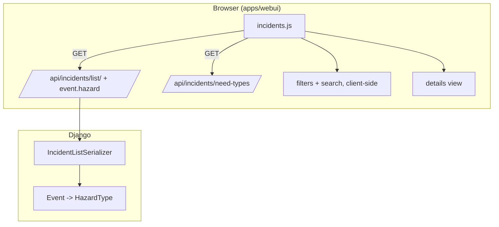

# Specification: Incident list: needs and hazard, filters, search and details view

**Status:** Draft (awaiting `/plan`)

## Executive Summary

Make the operator Incidents page a triage tool: show each incident's needs, urgency and its
event's hazard, let operators filter and search by them, and open any incident in a details view.
A small backend change adds the hazard to the incident list API (and possibly a single-incident
GET).

---

## Problem Statement

**Current State:**
- `/app/incidents/` shows reported, description, address, contact, status, task; search over
  description/address/phone; status dropdown.
- Needs, triage fields and event exist in the API but aren't shown; the hazard isn't in the API.
- No details view.

**Desired State:**
- Needs, urgency, event and hazard visible in the list; filterable and searchable; one click
  opens full details.

**Impact:**
- Faster triage during an event; operators can focus on one need or one emergency at a time.

---

## Goals & Success Criteria

### Primary Goals
1. Show needs, life-threatening/people count and event + hazard in the list.
2. Filters (need, status, event/hazard, life-threatening) and search that combine.
3. A details view for one incident.

### Success Criteria
- [ ] Acceptance criteria in `planning/requirements.md` met.
- [ ] Tests written first (Django + Vitest), watched fail, passing.
- [ ] Browser-checked at desktop and phone widths, light and dark.

### Non-Goals
- Editing from the details view, server-side pagination, volunteer assignment, Bangla UI.

---

## Architecture Overview

### High-Level System Architecture

---

## Technical Design

To be completed in `/plan`.

### Django Backend
- Models: none expected.
- Views/APIs: hazard in `IncidentListSerializer.event`; `select_related("event__hazard")`;
  possibly `GET /api/incidents/<id>/`.
- URLs: none new if the detail GET reuses `incident-detail`.
- Celery Tasks: none.

---

## Data Model Changes

None expected.

---

## API Specification

### Endpoint Overview
- `GET /api/incidents/list/`: `event` gains `hazard` `{code, label_en, icon, colour}`.
- `GET /api/incidents/<id>/` (to decide): one incident, operators only.

---

## Testing Strategy

To be completed in `/plan` (test-first).

### Unit Tests
- Django: list API hazard field and query count; detail GET (if added).
- Vitest: filtering, search, row/details rendering.

### Integration Tests
- 

### E2E Tests
- Browser check.

---

## Migration Plan

### Phase 1
- No data migration.

---

## Security Considerations

- Operator-only APIs; escaped text; validated icons/colours.

---

## Performance Considerations

- Client-side filtering over ≤500 incidents; constant-query list API.

---

## Summary

Turns the Incidents page into a filterable, searchable triage list with a details view.
