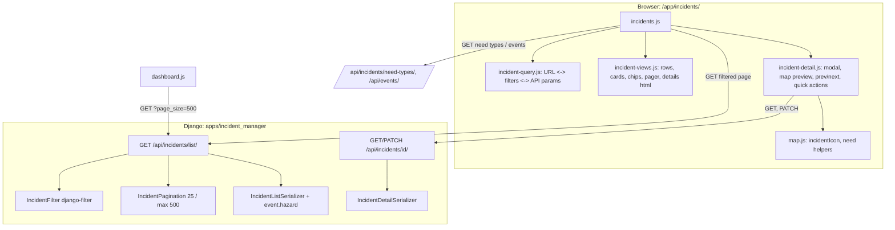

# Specification: Incident list: needs and hazard, filters, search and details view

**Status:** Planned, ready for `/execute`

## Executive Summary

Turn `/app/incidents/` into the operators' triage tool. The incident list API becomes
server-side filtered (needs, status, event/hazard, life-threatening, text search) and paginated,
and includes the event's hazard. The page gets a filter bar with need chips, a table (cards on
phones) showing needs, urgency and event + hazard, numbered pagination with state in the URL, and
a details pop-up with every field, a small map, Prev/Next, and quick actions to validate/reject
and correct triage. A new detail GET serves the pop-up. Shipped as one PR with ordered commits.

---

## Problem Statement

**Current State:**
- `/api/incidents/list/` returns the newest 500 as a plain array; `event` is `{id, name}`.
- `/app/incidents/` shows 6 plain columns; client-side search (description, address, phone) and a
  status dropdown; nothing about needs, urgency, event or hazard; no details; no actions.

**Desired State:**
- Operators find, read and act on any incident from one page, filtered by what's needed and
  which emergency it belongs to.

**Impact:**
- Faster triage during an event; operators stop needing the Django admin for routine work.

---

## Goals & Success Criteria

### Primary Goals
1. Server-side filters, search and pagination on the incident list API, with the hazard.
2. A list that shows needs, urgency and event + hazard, with a filter bar and URL state.
3. A details pop-up with map, Prev/Next and quick actions.

### Success Criteria
- [ ] All acceptance criteria in `planning/requirements.md` met.
- [ ] Every test under Testing Strategy written first, watched fail, passing.
- [ ] Browser-checked: desktop and phone, light and dark, operator and non-operator.

### Non-Goals
- Volunteer assignment, editing report text/location, bulk actions, full-text search, export,
  Bangla UI, real SMS.

---

## Decisions (from planning)

| Topic | Decision |
|-------|----------|
| Details view | Bootstrap **modal**; deep link `#incident-<id>` |
| Filters | Need (multi, any-of), Status, Event / hazard (incl. "No event"), Life-threatening only |
| Filter UI | Toolbar (search, Status, Event/hazard, Life-threatening toggle) + need chips row; "Showing x–y of n"; Clear |
| Where filtering happens | **Server-side** query params + pagination |
| API shape | Paginate `/api/incidents/list/` (`{count,next,previous,results}`); dashboard map uses `?page_size=500` |
| Paging | Numbered pages, 25 per page; filters/search/page in the page URL |
| Search | description, address, contact, district, thana, event name (`icontains`) |
| Pop-up content | All fields read-only + map preview + Prev/Next + quick actions |
| Quick actions | Validate / Reject / Pending + edit needs, life-threatening, people count, event, task status |
| Phones | Cards below 768px, table above |
| Delivery | One branch, one PR, a green commit per task group |

---

## Architecture Overview

---

## Technical Design

### Django Backend

**Models / migrations:** none. (`life_threatening` already indexed; FKs indexed.)

**`apps/incident_manager/filters.py`** (new) — `IncidentFilter(django_filters.FilterSet)`:
- `needs`: `CharFilter` with a method: split on `,`, strip, lowercase; unknown codes (not in
  `NeedType`) → `ValidationError` (400); `queryset.filter(needs__code__in=codes).distinct()`.
- `status`: `ChoiceFilter(field_name="validation_status", choices=IncidentStatus.choices())`.
- `event`: `CharFilter` method: `"none"` → `event__isnull=True`; an integer → `event_id`;
  anything else → 400.
- `hazard`: `CharFilter(field_name="event__hazard__code")`.
- `life_threatening`: `BooleanFilter`.
- `q`: `CharFilter` method: `Q(description__icontains) | Q(address__icontains) |
  Q(contact_number__icontains) | Q(district__name__icontains) | Q(thana__name__icontains) |
  Q(event__name__icontains)`; blank ignored.
- Invalid filter input returns 400 with field errors (django-filter `raise_exception`).

**`apps/incident_manager/pagination.py`** (new) — `IncidentPagination(PageNumberPagination)`:
`page_size = 25`, `page_size_query_param = "page_size"`, `max_page_size = 500`.

**`apps/incident_manager/apis.py`**
- `IncidentListView` → `generics.ListAPIView` (`IsAdminUser`, `IncidentListSerializer`,
  `IncidentFilter`, `IncidentPagination`); queryset
  `Incident.objects.select_related("event__hazard", "district", "thana").prefetch_related("needs")
  .order_by("-created_at", "-id")`. `MAX_RESULTS` slicing removed (pagination replaces it).
  Swagger docs list the query params.
- `IncidentDetailView`: add `get` (detail serializer, 404 if missing); `patch` responds with
  `IncidentDetailSerializer` (saves via the instance so the signal still fires).

**`apps/incident_manager/serializers.py`**
- `IncidentListSerializer.get_event` adds `hazard` via `HazardTypeSerializer` fields
  `{code, label_en, icon, colour}`.
- `IncidentDetailSerializer(IncidentListSerializer)`: adds `district` (name), `thana` (name),
  `provider` (name), `volunteer` (`{id, full_name}` or null), `updated_at`.

**URLs:** unchanged (`incident-list`, `incident-detail`).

**Signals / Celery:** unchanged; validating via PATCH queues `process_incident_and_send_sms`
(placeholder).

### Web dashboard (`apps/webui`)

**`constants.js`:** `API.events = '/api/events/'`, `API.incidentDetail = (id) => …`,
`INCIDENT_PAGE_SIZE = 25`, `DASHBOARD_MAP_PAGE_SIZE = 500`, `TASK_STATUSES`.

**`api.js`:** add `apiPatch`.

**`incident-query.js`** (new, pure):
- `readFilters(search)` → `{needs: [], status, event, hazard, lifeThreatening, q, page}` from the
  page URL query string (unknown keys ignored, page ≥ 1).
- `filtersToSearch(filters)` → page URL query string (defaults omitted, so a clean URL = no filters).
- `filtersToApiParams(filters)` → API query string (`needs=a,b&status=…&page=…&page_size=25`);
  the Event/hazard dropdown value `event:3` / `event:none` / `hazard:flood` maps to `event`/`hazard`.
- `withFilter(filters, change)` → new filters with `page` reset to 1 (unless only page changed).
- `pageRange(page, totalPages)` → `[1, '…', 4, 5, 6, '…', 12]`.
- `showingText(page, pageSize, count)` → `"Showing 26–50 of 148"` / `"No incidents match"`.

**`incident-views.js`** (new, pure HTML builders, all text escaped):
- `needIcons(incident, needTypes)` (icons + visually-hidden labels), `hazardLabel(event)`,
  `urgencyBadge(incident)`, `locationText(incident)`.
- `incidentTableRow(incident, needTypes)` (`<tr tabindex="0" data-incident-id>`),
  `incidentCard(incident, needTypes)`.
- `needChips(needTypes, selected)` (`<button aria-pressed>`), `eventHazardOptions(events, selected)`
  (optgroups Events / Hazards, plus All and No event).
- `pagerHtml(page, totalPages)`.
- `incidentDetailsHtml(incident, needTypes)` (read-only fields; Google Maps link
  `https://www.google.com/maps?q=lat,lng` when coordinates exist).
- `editFormHtml(incident, needTypes, events)`; `formToPatch(form)` → PATCH body;
  `formErrorsHtml(errors)`.

**`incident-detail.js`** (new): modal controller — `open(id)`, loads `GET /api/incidents/<id>/`,
renders details, creates/reuses one Leaflet map in the modal (`invalidateSize` on `shown.bs.modal`)
with `incidentIcon`, Prev/Next (buttons + ←/→ when focus isn't in a form field), asks the page
for adjacent page data at the edges, status buttons and edit form → `apiPatch`, then calls back
the page to refresh that row; keeps `#incident-<id>` in the URL hash; focus returns to the row on
close. Logic that decides prev/next ids (`adjacentIncident(ids, id, dir)`) is pure and tested.

**`incidents.js`** (page): loads need types and events once; reads filters from the URL;
fetches the page; renders chips, dropdowns, table, cards, pager, showing text; debounced search
(300 ms); `popstate` re-renders; opens the modal for `#incident-<id>` on load; 403 → operator
notice.

**`dashboard.js`:** `apiGet(API.incidents + '?page_size=500')` and use `.results`.

**`tables.js`:** remove `filterIncidents` / `incidentRow` (replaced); keep volunteer helpers.

**Templates:** `incidents.html` gets the filter bar, chips container, table + cards containers,
pager, and the modal markup; loads Leaflet (as on the dashboard).

**CSS (`hrs.css` / `app.css`):** `.hrs-need-icons`, `.hrs-incident-card`, clickable row hover/focus,
modal map size (`.hrs-detail-map`, 220px), urgency badge; reuse `.hrs-chip`, `.hrs-badge-*`.

**Docs:** `docs/development.md` API table (list params, pagination, detail GET);
`docs/design-system.md` (incident card, need icons).

---

## Data Model Changes

None.

---

## API Specification

| Method | Endpoint | Change |
|--------|----------|--------|
| GET | `/api/incidents/list/` | **Breaking:** paginated `{count, next, previous, results}`; filters `needs`, `status`, `event` (`<id>`/`none`), `hazard`, `life_threatening`, `q`; `page`, `page_size` (≤500); `event.hazard` added |
| GET | `/api/incidents/<id>/` | **New:** detail shape (operators) |
| PATCH | `/api/incidents/<id>/` | Response is now the detail shape |

Only in-repo client of `/list/` is the web dashboard (updated here). The breaking change is noted
in the PR description.

---

## Testing Strategy

Every test is written **before** the code it covers, watched fail for the expected reason, then
made to pass. Django tests run in Docker (`docker compose exec be python manage.py test …`);
Vitest on the host (`npx vitest run …`).

### Django: `apps/incident_manager/tests/test_incident_list_filters.py` (new)
| Test | Proves |
|------|--------|
| the list is paginated with 25 incidents per page by default and reports the total count | FR1 |
| page_size can be raised up to 500 but not beyond | FR1, FR5 |
| filtering by several needs returns incidents with any of them, each once | FR2 needs |
| an unknown need code is rejected with 400 | FR2 |
| filtering by status returns only that validation status; an invalid status is 400 | FR2 |
| filtering by event id returns its incidents and event=none returns incidents without an event | FR2 |
| a non-numeric event other than none is rejected with 400 | FR2 |
| filtering by hazard returns incidents whose event has that hazard | FR2 |
| filtering by life_threatening returns only urgent incidents | FR2 |
| search matches description, address, contact number, district, thana and event name, ignoring case | FR2 q |
| filters combine with each other and with search | FR2 |
| each result's event includes its hazard code, label, icon and colour | FR3 |
| a page of incidents takes the same number of queries whatever the page size | FR4 |
| non-operators cannot list incidents | security (regression) |

### Django: `apps/incident_manager/tests/test_incident_detail_api.py` (new, plus existing PATCH tests)
| Test | Proves |
|------|--------|
| an operator can fetch one incident with its district, thana, provider, volunteer and update time | FR6 |
| fetching a missing incident returns 404 | FR6 |
| non-operators cannot fetch an incident | security |
| updating an incident responds with the detail shape | FR7 |
| (existing PATCH and list tests updated to the paginated shape still pass) | regression |

### Vitest: `incident-query.test.js` (new)
| Test | Proves |
|------|--------|
| reads needs, status, event or hazard, life-threatening, search and page from the page URL | FR8 URL state |
| ignores unknown keys and treats a missing or invalid page as page 1 | robustness |
| writes only non-default filters back to the page URL | clean URLs |
| turns filters into API params with page and page size | FR1, FR2 |
| maps the event/hazard choice to the event or hazard API param, including no event | FR2 |
| changing any filter goes back to page 1, changing the page keeps the filters | FR8 |
| lists page numbers with ellipses around the current page | FR11 |
| describes which incidents are showing out of the total | FR8 |

### Vitest: `incident-views.test.js` (new)
| Test | Proves |
|------|--------|
| shows each need's icon in need-type order with its label for screen readers | FR9, a11y |
| shows the event with its hazard icon and label, or No event | FR9 |
| marks life-threatening incidents and shows the people count | FR9 |
| a table row can be opened by click or keyboard and carries the incident id | FR9, a11y |
| a card shows needs, urgency, status, message, place, event and time | FR10 |
| need chips show which needs are selected | FR8 |
| the event/hazard dropdown groups events and hazards and keeps the current choice | FR8 |
| the pager disables Prev on the first page and Next on the last | FR11 |
| the details show every field and a Google Maps link only when there are coordinates | FR12 |
| the edit form is pre-filled from the incident and turns back into a PATCH body | FR12 actions |
| a PATCH body always has at least one need, otherwise the form reports it | FR12 validation |
| server field errors are shown next to the right fields | FR12 errors |
| all incident text is escaped and unsafe icons or colours are ignored | security |

### Vitest: `incident-detail.test.js` (new, pure parts)
| Test | Proves |
|------|--------|
| next and previous move within the page and ask for the adjacent page at the edges | FR12 Prev/Next |
| there is no previous before the first incident or next after the last | FR12 |
| reads and writes the incident deep link in the URL hash | FR12 deep link |

### Vitest: existing suites
- `map.test.js` unchanged; `tables.test.js` drops `filterIncidents`/`incidentRow` tests with the
  functions; `api.test.js` gains "sends PATCH with a JSON body and the token".

### Manual (browser, headless Chromium)
- Desktop 1280 / phone 375, light/dark: filters, chips, search, pager and URL (refresh, back);
  open details from row and card; map preview; Prev/Next across a page edge; ←/→; deep link;
  validate/reject; edit needs/event and save; server error display; non-operator notice;
  dashboard map still shows pins.

---

## Migration Plan

### Phase 1
- No data migration. Deploy backend and webui together (the dashboard reads the paginated shape).

---

## Security Considerations

- All incident endpoints remain `IsAdminUser`. Filter input validated (400 on bad values);
  `page_size` capped at 500.
- All text escaped in the UI; icon names and colours pass `safeIcon`/`safeColour`.
- PATCH keeps using `IncidentOperatorSerializer` validation (needs non-empty, valid event).

---

## Performance Considerations

- `select_related("event__hazard", "district", "thana")` + `prefetch_related("needs")`: constant
  queries per page (tested). `distinct()` only when filtering by needs.
- `icontains` search scans; acceptable now, revisit (trigram/full-text index) if slow.
- Debounced search (300 ms) avoids a request per keystroke.

---

## Summary

Server-side filtered, paginated incident list with hazard; a triage-focused Incidents page with
need chips, URL state, cards on phones; and a details pop-up with map, Prev/Next and quick
actions — all test-first, one PR.
