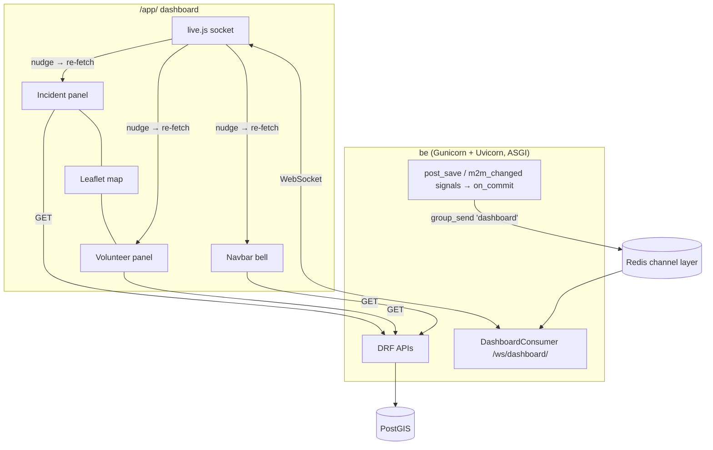
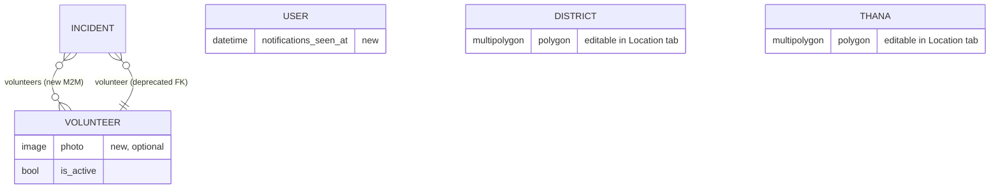

# Specification: Live three-panel dashboard (incidents, map, volunteers)

**Status:** Planned — ready for `/execute live-dashboard`
**Branch:** `feat/live-dashboard` (one branch, commits per task group, one PR)
**Mockup:** `live_dashboard.jpeg` (repo root)

## Executive Summary

Rebuild the operator dashboard (`/app/`) as the three-panel live view in the mockup:
- **Left:** an incident panel with a period dropdown, Pending / Resolved / Total cards that filter, Zilla/Upazilla filters, search and incident cards.
- **Centre:** the map.
- **Right:** a volunteer panel with Active / Inactive / Total counts, area filters, search and volunteer cards with photos.

The page stays live through WebSockets (Django Channels + Redis). The server sends a small "something changed" message and the page re-fetches through the existing APIs.

The same branch also delivers:
- **Several volunteers per incident**, assigned from the details modal or from the volunteer panel.
- **Volunteer photos.**
- **A navbar bell** counting new pending reports.
- **An avatar menu.**
- **A Location tab** where operators manage districts and thanas, with optional GeoJSON boundaries.

---

## Decisions (from /plan interview)

| Topic | Decision |
|---|---|
| "Resolved" | Resolved = `task_status == "closed"` (labelled "Resolved" in the app). Pending = `validation_status == "pending"`. Total = every incident in the period. No new status, no migration. |
| Volunteers per incident | New M2M `Incident.volunteers`. A data migration copies today's `Incident.volunteer` FK into it. The FK stays one release, deprecated, and is no longer written or read by the app. |
| Volunteer status and photo | Active/Inactive come from `Volunteer.is_active`. New optional `Volunteer.photo` ImageField, uploaded in Django admin; the app shows initials when it's missing. The volunteers API becomes operator-only and returns active **and** inactive volunteers. |
| Live updates | Server push over WebSockets with Django Channels and a Redis channel layer. |
| WS server | `be` switches to ASGI: Gunicorn with Uvicorn workers (`config/asgi.py`), one service on port 8001. |
| WS payload | Nudge, then re-fetch: `{"type": "incident.changed", "id": 12}` or `{"type": "volunteer.changed", "id": 3}`. If the socket drops, the page reconnects with backoff and re-fetches once. |
| Navbar | Bell = count of pending incidents reported since the user last opened the bell (last-seen time stored on the server). Avatar menu = initials + theme toggle + Sign out. Location tab = manage districts/thanas. |
| Location tab | Operators add, rename and delete districts and thanas (delete is blocked while incidents or volunteers use them) and can upload a GeoJSON boundary, previewed on a small map. |
| Period dropdown | Today (since midnight, Bangladesh time UTC+6) · Last 24 hours · Last 7 days · Active event. Default Today. Kept in the URL. |
| Interaction | Status cards filter the list and pins (default Pending). Selecting a list card highlights it, pans the map and opens the pin popup. Clicking a pin highlights and scrolls to its card. "View details" opens the existing details modal. |
| Mobile (< 992px) | The map fills the screen. A bottom bar switches Incidents / Map / Volunteers, and each list is a full-height sheet. On desktop the side panels collapse to a rail via their chevrons, remembered in localStorage. |
| Assignment | Both places: a volunteer multi-select in the details modal's edit form, and Assign/Unassign on volunteer cards while an incident is selected. With an incident selected, volunteers are listed nearest first. |
| Delivery | One branch, staged commits per task group, one PR. |

---

## Problem Statement

**Current State:**
- `/app/` shows four summary cards and a full-width map. The incident list is on a separate page and data loads once.
- An incident holds at most one volunteer (`Incident.volunteer` FK), and nothing in the app assigns one.
- `GET /api/volunteers/volunteers/` is `AllowAny`. It returns only active volunteers and a few fields (no id, phone, district or thana).
- There's no notification indicator, no Location page and no avatar. The navbar shows the username, a theme button and Log out.
- Districts and thanas have no boundary shapes in practice, so pin-based area detection for web reports never matches.

**Desired State:**
- A single live control screen matching the mockup, with linked list and map, area filters, live counts and volunteer assignment.

**Impact:**
- Operators triage and assign help from one screen and see new reports within seconds, without reloading.

---

## Goals & Success Criteria

### Primary Goals
1. A three-panel dashboard matching the mockup on desktop, with a bottom-tab layout on phones.
2. Period, status and area filters, with counts that agree with the list and the pins.
3. Several volunteers per incident, assigned from the modal or the panel.
4. Live updates over WebSockets, plus the bell.
5. Operators manage districts and thanas (with boundaries) in the Location tab.

### Success Criteria
- [ ] For any period and area, the Pending / Resolved / Total cards equal the API counts, and the list and pins show the same incidents as the selected card.
- [ ] Selecting a list card pans the map and opens its popup; clicking a pin highlights and scrolls to its card.
- [ ] An incident created or changed in another tab appears on the dashboard within 2 seconds, with no reload.
- [ ] Volunteers panel: Active / Inactive / Total counts, Zilla/Upazilla filters, search, photo or initials avatar with a green or grey dot.
- [ ] Assigning or unassigning a volunteer updates the incident card's "N volunteers" badge in every open dashboard.
- [ ] The bell counts pending reports since it was last opened, and opening it clears the count.
- [ ] Location tab: operators add, rename and delete districts and thanas; delete is refused while in use; an uploaded GeoJSON boundary is stored and used by pin detection.
- [ ] Non-operators: the volunteer, summary, notification, assignment and place-management APIs return 403. The dashboard shows them the existing report panel, and the WebSocket refuses them.
- [ ] Usable at 375px width; keyboard reachable; no horizontal page scroll.
- [ ] All new behaviour has tests written first; the Django and Vitest suites pass in CI.

### Non-Goals
- Volunteer self-service (volunteers signing in, sending live location).
- Uploading photos from the web app (admin only for now).
- Drawing boundaries on the map (GeoJSON upload only).
- Push notifications outside the open page (email, SMS, browser push).
- Removing the deprecated `Incident.volunteer` FK (next release).

---

## Architecture Overview

---

## Technical Design

### Django backend

**Dependencies** (`pyproject.toml`/`poetry.lock`, the images run Python 3.8):
- `channels` ^4.1
- `channels-redis` ^4.2
- `uvicorn[standard]` ^0.33 (last version supporting 3.8)
- `Pillow` ^10.4

**Settings** (`config/settings.py`):
- `ASGI_APPLICATION = "config.asgi.application"` and add `"channels"` to `INSTALLED_APPS`.
- Channel layers:
  - `CHANNEL_LAYERS` uses `channels_redis.core.RedisChannelLayer` at `REDIS_URL` (default `redis://redis:6379/1`).
  - Tests override it to `channels.layers.InMemoryChannelLayer`.
- Media: `MEDIA_URL="/media/"` and `MEDIA_ROOT=BASE_DIR/"media"`, served in DEBUG via `static()`. Add `media/` to `.gitignore`.
- `DASHBOARD_UTC_OFFSET_HOURS = 6`: Bangladesh time, with no DST.
- Throttle (`THROTTLE_RATE`):
  - Raise the default to `1000/hour`. Re-fetches after nudges are bursty.
  - Nudges are debounced client-side, at most one re-fetch per 2 s.

**Server** (`config/asgi.py`, `config/gunicorn.conf.py`, `entrypoint_web.sh`):
- `ProtocolTypeRouter`:
  - `http` → Django.
  - `websocket` → `AllowedHostsOriginValidator(URLRouter([path("ws/dashboard/", DashboardConsumer.as_asgi())]))`.
- Gunicorn `worker_class = "uvicorn.workers.UvicornWorker"`. Reload in dev is kept.
- `entrypoint_web.sh` runs `config.asgi:application`.

**Models and migrations:**

`apps/incident_manager/models/incident.py`:
- `volunteers = ManyToManyField(Volunteer, related_name="assigned_incidents", blank=True)`.
- `volunteer` FK: add `help_text="Deprecated: use volunteers."`.
- Migration `0012_incident_volunteers`: schema, plus a data migration copying `volunteer_id` into `volunteers` (with a reverse).

`apps/volunteer_hub/models/volunteer.py`:
- `photo = ImageField(upload_to="volunteers/", null=True, blank=True)`.
- Validation: at most 2 MB and JPEG/PNG/WebP, via `FileExtensionValidator` plus a size validator.

`apps/user/models.py`:
- `notifications_seen_at = DateTimeField(null=True, blank=True)`.

**Shared helpers:**

`services/periods.py`:
- `period_start(period, now)` returns the start time for the `today`, `24h` and `7d` periods.
- `today` = midnight at UTC+6, converted to UTC.
- `event` uses `Event.objects.active()` and filters `event__in`.
- Unknown periods give a 400.

`services/broadcast.py`:
- `notify(kind, id)` → `transaction.on_commit(lambda: async_to_sync(layer.group_send)("dashboard", {"type": "dashboard.nudge", "kind": kind, "id": id}))`.
- If the layer errors, it logs and never breaks the save.

`signals.py` calls it on:
- Incident `post_save`;
- `Incident.volunteers.through` `m2m_changed` (post_add/post_remove/post_clear);
- Volunteer `post_save`.

**Filters** (`apps/incident_manager/filters.py`, `IncidentFilter`):
- `period` (`today|24h|7d|event`, 400 otherwise);
- `district` and `thana` (ids);
- `task_status` (ChoiceFilter; the web app sends `closed` for Resolved).

**Serializers:**

`IncidentListSerializer` adds:
- `task_status`;
- `district`/`thana` names (if missing);
- `volunteer_count`: an annotated `Count("volunteers", distinct=True)` on the queryset, so there is no N+1.

`IncidentDetailSerializer`:
- Replaces `volunteer` with `volunteers: [{id, full_name, photo}]`.
- Prefetches `volunteers`.

`OperatorUpdateSerializer`:
- Accepts `volunteers` (a list of ids) and sets the M2M.
- Unknown ids give a 400.

`VolunteerSerializer` (operator view), fields:
- `id`, `full_name`, `contact_number`;
- `latitude`, `longitude`;
- `district` `{id,name}`, `thana` `{id,name}`;
- `is_active`;
- `photo` (absolute URL or null);
- `skills`, `address`;
- `assigned_incident_count` (annotated);
- `distance_km` (only with `near`).

**APIs** (all `IsAdminUser` = operators unless noted):

| Method | Path | Purpose |
|---|---|---|
| GET | `/api/incidents/summary/?period=&district=&thana=&q=` | `{"pending": n, "resolved": n, "total": n}` over the same filtered queryset as the list (minus the status filter), one aggregate query. |
| GET | `/api/incidents/list/?…&period=&district=&thana=&task_status=` | Existing list plus the new filters and `volunteer_count`. |
| PATCH | `/api/incidents/<id>/` | Existing update, now accepts `volunteers: [ids]`. |
| POST | `/api/incidents/<id>/volunteers/` `{"volunteer": id}` | Assign one (idempotent, 200 with the new `volunteer_count`). |
| DELETE | `/api/incidents/<id>/volunteers/<vid>/` | Unassign one (204; 404 if not assigned). |
| GET | `/api/volunteers/volunteers/?active=&district=&thana=&q=&near=lat,lng` | Operator-only (**was AllowAny**). All volunteers; `active=true/false`; `near` orders by distance and adds `distance_km`. |
| GET | `/api/volunteers/summary/?district=&thana=&q=` | `{"active": n, "inactive": n, "total": n}`. |
| GET | `/api/incidents/notifications/` | `{"unread": n, "results": [10 newest pending incidents created after notifications_seen_at]}`. |
| POST | `/api/incidents/notifications/seen/` | Sets `notifications_seen_at = now`, returns `{"unread": 0}`. |
| GET/POST | `/api/incidents/places/manage/districts/` | List (with incident/volunteer counts) and create districts. |
| PATCH/DELETE | `/api/incidents/places/manage/districts/<id>/` | Rename, set or clear the boundary, delete (409 when in use). |
| GET/POST | `/api/incidents/places/manage/thanas/?district=` | The same for thanas (`district` required on create). |
| PATCH/DELETE | `/api/incidents/places/manage/thanas/<id>/` | Same, 409 when in use. |

Places (`District`, `Thana` in `models/address.py`):
- `polygon` (MultiPolygon) already exists and is reused as the boundary.
- `District` requires a `division`: creating one needs `division` (id), and a read-only `GET /api/incidents/places/manage/divisions/` feeds the dropdown.
- Names are unique (model constraint): a duplicate gives a 400.
- Deleting cascades to thanas in the model, so the API guard refuses (409) when the district, any of its thanas, or an event uses the area. It also refuses when incidents or volunteers point at it.

Boundary input:
- `boundary` is GeoJSON `Polygon` or `MultiPolygon` (as an object), stored as `MultiPolygon` in SRID 4326.
- A bad geometry, another type, or a boundary not intersecting Bangladesh's bounding box gives a 400.
- `null` clears it.
- Responses include `boundary` as GeoJSON.

The existing `GET /api/incidents/places/` (any signed-in user) is unchanged.

**WebSocket** (`apps/incident_manager/consumers.py`, `DashboardConsumer(AsyncJsonWebsocketConsumer)`):
1. On connect, accept.
2. The client's first message must be `{"type": "auth", "token": "<JWT access>"}`. The token goes in a message, not the URL, so it isn't logged.
3. Validate it with simplejwt `AccessToken`, then load the user via `database_sync_to_async`.
4. If the user isn't an active staff member, or no auth message arrives within 5 s, close with code 4401 or 4403.
5. On success, join group `dashboard` and reply `{"type": "ready"}`.
6. `dashboard_nudge(event)` sends `{"type": f"{kind}.changed", "id": id}`.

**Admin:**
- Volunteer admin shows a `photo` thumbnail and `is_active` in `list_filter`.
- Incident admin uses `filter_horizontal = ["volunteers"]`.

### Web app (`apps/webui/`)

**Templates:**

`dashboard.html` (rewritten), using `hrs-dashboard` (full-height, no container):
- `aside.hrs-panel--incidents`, `section.hrs-dashboard-map`, `aside.hrs-panel--volunteers`;
- `nav.hrs-dash-tabs` (mobile bottom bar);
- the report modal and the details modal include. The details modal markup moves from `incidents.html` into `components/incident_detail_modal.html` and is reused.

`base.html`:
- Tabs: Dashboard, Incidents, Volunteers, Location, with mockup icons.
- Bell button with a badge and dropdown.
- Avatar button (initials) with a dropdown: name, theme toggle, Sign out.
- These replace `#currentUser`, `#themeToggle` and `#logoutBtn`.
- The Location tab is shown only to operators.

`locations.html` (new), at the `/app/locations/` route with `page="locations"`.

**JS modules** (pure helpers tested with Vitest; thin controllers):

`dashboard-query.js`:
- `readDashboardState(search)` returns `{period, status: pending|resolved|all, district, thana, q, vq, selected}`.
- `dashboardToSearch`;
- `incidentApiParams(state)`: maps `resolved` → `task_status=closed`, `pending` → `status=pending`, and `page_size=500`;
- `summaryApiParams`, `volunteerApiParams(state, selectedIncident)` (adds `near`);
- `showingText(count, status)`: "Showing 32 Pending Incidents" / "Showing All Volunteers".

`dashboard-views.js`:
- `incidentTitle(i)`: "Feni-Parshuram Incident", falling back to the address or "Incident #id";
- `dashIncidentCard(i, {selected})`: date, time, district/thana, truncated message, "N volunteers", status badge, "View details";
- `incidentPopupCard(i)`;
- `statusCards(summary, active)`;
- `volunteerCard(v, {selectedIncident, assigned})`;
- `avatarHtml(name, photo, active)`: photo or initials, plus the dot;
- `initials(name)`;
- `areaSelects(places, district, thana)`.

`dashboard-layout.js`:
- `panelState(storage)` / `setPanelCollapsed`;
- `mobileTab` switching (`incidents|map|volunteers`) with `aria-selected`.

`live.js`:
- `createLiveSocket({url, token, WebSocket, onNudge, onStatus, timers})`.
- Sends auth first; reconnects with backoff of 1, 2, 4… up to 30 s; calls `onStatus('live'|'reconnecting'|'offline')`; re-fetches once after a reconnect.
- `debounceNudges(fn, 2000)`.

`notifications.js`:
- `bellBadgeText(n)` (`9+`);
- `notificationItemHtml(i)`;
- `createBell({element, apiGet, apiPost})`, which refreshes on nudges.

`avatar-menu.js`: `userInitials(user)` plus menu wiring (theme toggle reuses `theme.js`).

`locations-views.js`:
- `districtRowHtml`, `thanaRowHtml`;
- `readBoundaryFile(text)`: parses GeoJSON (Feature, FeatureCollection with one polygon, Polygon, MultiPolygon) and returns `{geometry}` or `{error}`.

`dashboard.js`, the controller:
- Loads places, need types, summary, incidents and volunteers.
- Draws panels and pins, and links list and map.
- Assign/Unassign buttons POST/DELETE.
- Opens the live socket and debounced re-fetch.
- Non-operators (403) get `reportPanelHtml()` as before.

`incidents.js`/`incident-views.js`:
- The edit form gets a volunteers multi-select (searchable `<select multiple>`), sent as `volunteers`.
- The details show assigned volunteers.

`volunteers.js` (Volunteers page): adapt to the new response shape (now operator-only).

`map.js`:
- `drawMarkers` returns a `markersById` map, so the controller can `openPopup()` and pan.
- The popup uses `incidentPopupCard`.
- Volunteer markers are grey when inactive.

**CSS** (`hrs.css`):
- `.hrs-dashboard` grid: `320px 1fr 320px`, height `calc(100dvh - navbar)`.
- Collapsed rail 48px.
- `.hrs-panel*`, `.hrs-stat-card--pending|resolved|total|active|inactive` (mockup colours from tokens).
- `.hrs-dash-card` (selected = tinted background), `.hrs-vol-badge`, `.hrs-avatar` + `.hrs-avatar-dot--on|off`.
- `.hrs-dash-tabs` (fixed bottom bar under 992px), `.hrs-bell-badge`.
- Light and dark tokens only, no hard-coded colours.

---

## Data Model Changes

Migrations:
- `incident_manager.0012` (M2M plus a data copy, reversible);
- `volunteer_hub` (photo);
- `user` (`notifications_seen_at`).

---

## Testing Strategy (test-first)

Each test below is written and seen failing before its code. Names are the behaviour they prove.

### Backend: models and migrations
- `test_assigning_volunteers_to_an_incident_keeps_all_of_them` (M2M).
- `test_the_data_migration_copies_the_single_volunteer_into_the_volunteers_list` (MigrationExecutor test, like `test_skills_migration.py`).
- `test_a_volunteer_photo_must_be_an_image_of_at_most_2_mb`.

### Backend: periods and filters (`test_dashboard_filters.py`)
- `test_today_starts_at_midnight_bangladesh_time_not_utc` (frozen clock at 2026-11-04 19:00 UTC = 01:00 BD).
- `test_last_24_hours_and_last_7_days_include_only_incidents_created_in_that_window`.
- `test_active_event_period_lists_only_incidents_attached_to_an_active_event`.
- `test_an_unknown_period_is_rejected_with_400`.
- `test_district_and_thana_filters_narrow_the_list_by_id`.
- `test_task_status_closed_lists_only_resolved_incidents`.
- `test_each_listed_incident_has_its_volunteer_count_without_extra_queries` (CaptureQueriesContext).

### Backend: summary (`test_incident_summary_api.py`)
- `test_summary_counts_pending_resolved_and_total_for_the_period_and_area`.
- `test_summary_matches_the_list_count_for_the_same_filters`.
- `test_summary_is_one_query` and `test_non_operators_cannot_read_the_summary`.

### Backend: assignment (`test_incident_volunteers_api.py`)
- `test_an_operator_can_assign_a_volunteer_and_assigning_again_changes_nothing`.
- `test_unassigning_removes_only_that_volunteer` / `test_unassigning_someone_not_assigned_is_404`.
- `test_patching_volunteers_replaces_the_list` / `test_unknown_volunteer_ids_are_rejected`.
- `test_details_list_the_assigned_volunteers_with_photos`.
- `test_non_operators_cannot_assign`.

### Backend: volunteers API (update `test_get_volunteer.py`)
- `test_only_operators_can_list_volunteers` (**regression: was AllowAny**).
- `test_operators_see_active_and_inactive_volunteers_with_phone_area_and_photo`.
- `test_active_district_thana_and_search_filters`.
- `test_near_orders_volunteers_by_distance_and_reports_km`.
- `test_volunteer_summary_counts_active_inactive_and_total`.

### Backend: notifications (`test_notifications_api.py`)
- `test_unread_counts_pending_incidents_reported_since_the_bell_was_last_opened`.
- `test_a_user_who_never_opened_the_bell_sees_the_last_24_hours`.
- `test_marking_seen_resets_unread_to_zero_for_that_user_only`.
- `test_non_operators_get_403`.

### Backend: Location management (`test_place_management_api.py`)
- `test_operators_can_create_rename_and_delete_districts_and_thanas`.
- `test_deleting_a_district_or_thana_in_use_is_refused_with_409` (incidents, volunteers, an event, or a used thana inside the district).
- `test_creating_a_district_needs_a_division_and_a_unique_name`.
- `test_a_geojson_polygon_boundary_is_stored_as_a_multipolygon`.
- `test_bad_geojson_a_point_or_a_boundary_outside_bangladesh_is_rejected`.
- `test_an_uploaded_boundary_is_used_to_detect_the_area_of_a_web_report` (integration with `create_incident`).
- `test_non_operators_cannot_manage_places`.

### Backend: live updates (`test_dashboard_socket.py`, `channels.testing.WebsocketCommunicator`, in-memory layer, `TransactionTestCase`)
- `test_an_operator_with_a_valid_token_joins_and_gets_ready`.
- `test_a_non_operator_or_bad_token_is_closed_with_4403_or_4401`.
- `test_no_auth_message_within_the_timeout_closes_the_socket` (timeout patched short).
- `test_saving_an_incident_nudges_connected_dashboards_after_commit`.
- `test_assigning_a_volunteer_and_saving_a_volunteer_send_nudges`.
- `test_a_channel_layer_error_does_not_break_saving_an_incident`.

### Web app (Vitest, written first next to each module)
- `dashboard-query.test.js`:
  - state round-trips through the URL;
  - Resolved maps to `task_status=closed`;
  - `near` is sent only with a selected incident;
  - showing-text wording.
- `dashboard-views.test.js`:
  - title from district-thana, with fallbacks;
  - card shows date, time, place, truncated message, "1 volunteer"/"N volunteers", status badge;
  - selected class;
  - avatar photo vs initials and on/off dot;
  - Assign vs Unassign button;
  - everything escaped (XSS cases).
- `live.test.js` (fake WebSocket and timers):
  - sends auth first;
  - nudges call the handler;
  - backoff doubles to 30 s and resets after ready;
  - re-fetch once after reconnect;
  - a 4403 close stops retrying;
  - debounce collapses bursts.
- `notifications.test.js`: badge text (0 hidden, 9+), item HTML escaped.
- `dashboard-layout.test.js`: collapsed state remembered (storage failures tolerated); mobile tab switching sets `aria-selected` and `hidden`.
- `locations-views.test.js`: GeoJSON Feature/FeatureCollection/Polygon/MultiPolygon accepted; Point, broken JSON and several features rejected with messages.
- `map.test.js`: `drawMarkers` returns markers by id; inactive volunteers drawn grey.
- `incident-views.test.js`: the edit form includes the volunteers multi-select; `formToPatch` sends volunteer ids.

### E2E (headless Chromium via Playwright scripts in the scratchpad, not committed)
- Desktop 1280×800:
  - panels and counts match the API;
  - selecting a card opens the popup;
  - clicking a pin scrolls to its card;
  - collapse/expand both panels;
  - assign/unassign updates the badge.
- A second browser context creates an incident; the first dashboard shows it within 2 s without reload, and the bell count rises.
- Phone 375×812: bottom tabs switch sheets; no horizontal scroll.
- Location tab: create a district and thana, upload GeoJSON, delete refused while in use.

### Mutation checks
After green, break key lines and confirm a test fails:
- the period offset;
- the summary filter;
- the auth check in the consumer;
- the `on_commit` wrap;
- the 409 guard;
- the `near` ordering.

Afterwards, restore with `git checkout`.

---

## Migration Plan

1. Deploy runs `migrate` (three migrations). The data migration copies existing single assignments.
2. Rebuild images: new Python dependencies (Channels, channels-redis, Uvicorn, Pillow).
3. The `be` server command changes to the Uvicorn worker; Redis must be reachable from `be`.
4. Behaviour changes to announce:
   - `/api/volunteers/volunteers/` now needs an operator login and returns inactive volunteers too, with a new field set;
   - `Incident.volunteer` is deprecated in favour of `volunteers`;
   - the default `THROTTLE_RATE` rises to 1000/hour.
5. A `media/` volume or folder is needed for photos in production.

---

## Security Considerations

- Every new endpoint and the socket are operator-only. The socket checks staff status on the token, not just a valid token.
- The JWT goes in the first socket message, never in the URL, so it doesn't end up in server logs.
- `AllowedHostsOriginValidator` blocks cross-site socket connections.
- Nudges carry only a kind and an id, never incident data. Data still goes through permission-checked APIs.
- Photos: size and type validated. Served from `MEDIA_URL`, never rendered as HTML.
- GeoJSON is parsed with GEOS, with type and bounds checked. File reading happens in the browser and only geometry JSON is sent.
- All card, popup and notification text is escaped (tested).

---

## Performance Considerations

- The list annotates `volunteer_count` (one query). The summary is one aggregate with `Count(filter=Q(...))`.
- The dashboard loads at most 500 pins per period (as today). The volunteer list is unpaginated (operator scale, hundreds).
- Nudge bursts are debounced to one re-fetch per 2 s per tab. Only the affected side (incidents or volunteers) is re-fetched.
- Uvicorn workers handle sockets asynchronously; DB work in the consumer only happens at auth.

---

## Summary

The operator dashboard becomes the mockup's live three-panel control screen, built on:
- several volunteers per incident;
- volunteer photos;
- operator-only volunteer, summary and notification APIs;
- Channels WebSocket nudges.

The navbar gains the bell, the avatar menu and a Location tab for managing districts, thanas and their boundaries.
