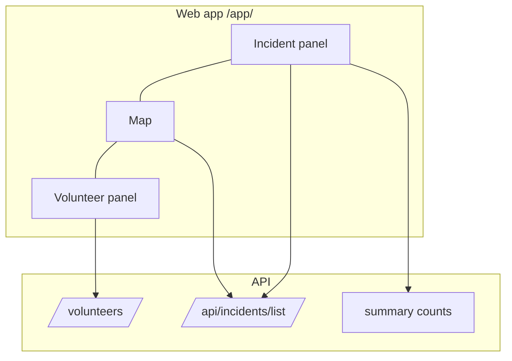

# Specification: Live three-panel dashboard (incidents, map, volunteers)

**Status:** Initialized — to be planned with `/plan live-dashboard`

## Executive Summary

Rebuild the operator dashboard (`/app/`) as the three-panel live view in `live_dashboard.jpeg`:
incidents on the left, the map in the centre, volunteers on the right, updating by itself.

---

## Problem Statement

**Current State:**
- The dashboard shows summary cards and a full-width map; the incident list is a separate page.
- Incident statuses are pending / validated / rejected; there is no "resolved".
- Volunteers have no active/inactive summary on the dashboard; incidents show no volunteer count.
- Data loads once per page view.

**Desired State:**
- One screen with a filterable incident list, the map and a volunteer list, linked together and kept up to date.

**Impact:**
- Faster triage and assignment for operators during an event.

---

## Goals & Success Criteria

### Primary Goals
1. Three-panel layout matching the mockup.
2. Period, status and area filters with matching counts.
3. Linked list-map selection and live updates.

### Success Criteria
- [ ] See planning/requirements.md acceptance criteria.

### Non-Goals
- To be settled in /plan.

---

## Architecture Overview

### High-Level System Architecture

---

## Technical Design

### Django Backend
- Models: TBD in /plan (resolved status, volunteer active state, volunteers per incident).
- Views/APIs: TBD (summary counts, period filter, volunteer filters).
- URLs: TBD.
- Celery Tasks: none expected.

---

## Data Model Changes

TBD in /plan.

---

## API Specification

### Endpoint Overview
TBD in /plan.

---

## Testing Strategy

### Unit Tests
- TBD (test-first, per the `tdd` skill).

### Integration Tests
- TBD.

### E2E Tests
- Headless browser check of the three panels on desktop and phone widths.

---

## Migration Plan

### Phase 1
- TBD.

---

## Security Considerations

- Incident and volunteer data stay operator-only.

---

## Performance Considerations

- Polling (if chosen) must stay within the API throttle and use bounded queries.

---

## Summary

The dashboard becomes the operators' live control screen described by the mockup.
