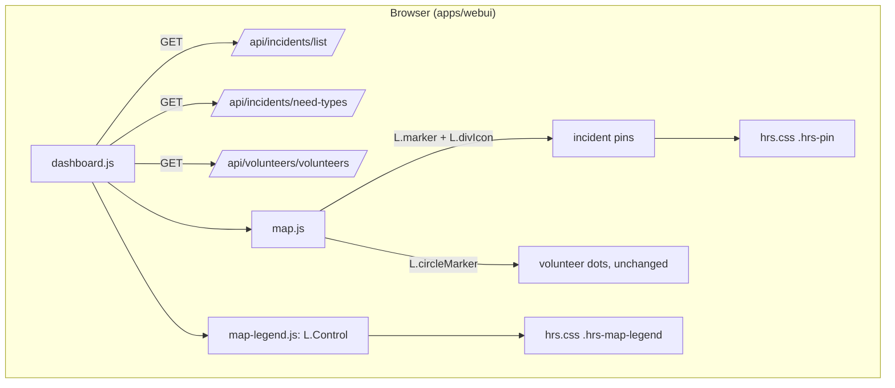

# Specification: Need-type icons on the incident map

**Status:** Planned, ready for `/execute`

## Executive Summary

Replace the plain status-coloured circles on the dashboard map with **teardrop pins** that show
each incident's main need (rescue, medical, food, …) as a white icon on the need's colour. The
pin's **outline** shows validation status (rejected pins are faded), a **"+N"** badge counts
extra needs and a red **"!"** badge marks life-threatening incidents, which are drawn on top. A
**collapsible legend on the map** explains needs, status and volunteers. Icons and colours come
from the admin-editable need types added in #75, so a new need type shows up without a deploy.
Frontend only; no backend change.

---

## Problem Statement

**Current State:**
- Incidents are `L.circleMarker`s coloured only by validation status (`map.js`).
- `needs`, `life_threatening` and `people_count` are in `GET /api/incidents/list/` since #75, but
  the map ignores them. The footer legend only lists statuses and volunteers.

**Desired State:**
- Operators can tell what help is needed, and which incidents are life-threatening, from the map,
  while still seeing validation status.

**Impact:**
- Faster triage; the map works for any hazard because needs are hazard-agnostic.

---

## Goals & Success Criteria

### Primary Goals
1. Show the main need as the pin's icon and fill colour.
2. Keep validation status visible (outline, fade) and make life-threatening incidents stand out.
3. Explain everything in one collapsible on-map legend.

### Success Criteria
- [ ] All acceptance criteria in `planning/requirements.md` are met.
- [ ] The Vitest tests listed under Testing Strategy were written first, watched fail, and pass.
- [ ] Checked in the browser in light and dark themes, on desktop and phone widths.

### Non-Goals
- Map filters by need or event, editing needs on the dashboard, marker clustering, volunteer
  icons by skill, Bangla labels in the UI.

---

## Decisions (from planning)

| Topic | Decision |
|-------|----------|
| Marker shape | Teardrop pin, tip on the point |
| Status | Pin outline in the status colour; rejected also faded |
| Legend place | On the map, bottom-right, collapsible |
| Legend state | Open ≥768px, collapsed below; user's toggle remembered in localStorage |
| Legend content | Needs + Status (incl. "!" life-threatening) + Volunteer; footer legend removed |
| Earlier draft code | Discarded; implement fresh, test-first |

---

## Architecture Overview

---

## Technical Design

### Django Backend
- Models, views, URLs, serializers, signals, Celery tasks: **no change**. Reuses
  `IncidentListView` (`needs` as codes, `life_threatening`, `people_count`) and
  `NeedTypeListView` (`code`, `label_en`, `label_bn`, `icon`, `colour`, `is_fallback`; active only,
  ordered by `sort_order`, operators only).

### Web dashboard (`apps/webui`)

**`static/webui/js/constants.js`**
- `API.needTypes = '/api/incidents/need-types/'`.
- `GENERIC_NEED = { code: '', label_en: 'Unclassified', icon: 'question-circle', colour: '#64748B' }`.
- `LEGEND_STORAGE_KEY = 'hrs.mapLegend.open'`, `LEGEND_WIDE_QUERY = '(min-width: 768px)'`.

**`static/webui/js/map.js`** (pure helpers + drawing)
- `safeIcon(name)` → `name` if it matches `^[a-z0-9-]+$`, else the generic icon.
- `safeColour(value)` → `value` if it matches `^#[0-9a-fA-F]{6}$`, else the generic colour.
- `incidentNeeds(incident, needTypes)` → the incident's need types in `sort_order` (unknown codes
  dropped).
- `primaryNeed(incident, needTypes)` → first of `incidentNeeds`, else the `is_fallback` type, else
  `GENERIC_NEED`.
- `incidentPinHtml(incident, needTypes)` → markup:
  `[ hrs-pin--urgent]" style="--hrs-pin-fill:<colour>"
  role="img" aria-label="<needs>[, life-threatening], <status>">` + inline SVG teardrop (fill
  `var(--hrs-pin-fill)`, stroke from the status class) + `<i class="bi bi-<icon>">` + optional
  `+N` + optional `!`.
  Unknown status → `pending`.
- `incidentIcon(L, incident, needTypes)` → `L.divIcon({ className: 'hrs-pin-wrap', html,
  iconSize: [PIN_W, PIN_H], iconAnchor: [PIN_W / 2, PIN_H], popupAnchor: [0, -PIN_H + 4] })`
  with `PIN_W = 32`, `PIN_H = 42` (tip on the point).
- `incidentPopup(i, needTypes)` adds need labels, "Life-threatening" and "N people" (escaped).
- `drawMarkers(L, map, incidents, volunteers, needTypes = [])` draws incidents with
  `L.marker(latlng, { icon, riseOnHover: true, zIndexOffset: life_threatening ? 1000 : 0 })`.
  Volunteers stay `circleMarker`s. Layer toggle and fit-bounds unchanged.
- `incidentMarkerColor` (status circle colour) is removed once nothing uses it.

**`static/webui/js/map-legend.js`** (new)
- `legendHtml(needTypes)` → sections: Needs (only if any need types), Status (Pending,
  Validated, Rejected as pin outlines, plus "! Life-threatening"), Volunteer. Labels escaped,
  icons/colours via `safeIcon`/`safeColour`.
- `legendInitiallyOpen(stored, isWide)` → `stored === 'true'|'false'` wins, else `isWide`.
- `addLegend(L, map, needTypes, { storage = window.localStorage, isWide })` → a Leaflet control
  at `bottomright` with a header `<button aria-expanded aria-controls>` that toggles the body,
  saves the state (storage errors ignored), and stops click/scroll propagation to the map
  (`L.DomEvent.disableClickPropagation` / `disableScrollPropagation`).

**`static/webui/js/dashboard.js`**
- Fetch need types alongside incidents and volunteers; pass them to `drawMarkers` and
  `addLegend`. A failed need-type call is not an error toast (map still works).

**`static/webui/css/hrs.css`** (design system component, scoped under `.leaflet-container`)
- `.hrs-pin-wrap` (reset Leaflet's divIcon background/border), `.hrs-pin`, SVG stroke per
  `.hrs-pin--pending|validated|rejected` from `--hrs-status-*`, `.hrs-pin--rejected` opacity,
  `.hrs-pin-count`, `.hrs-pin-alert` (`--hrs-danger`), white icon with subtle shadow.
- `.hrs-map-legend` (surface, border, radius, shadow tokens; max-height with scroll on small
  screens; light/dark via tokens).

**`templates/webui/dashboard.html`**
- Remove the card-footer legend.

**`docs/design-system.md` + `/app/design/`**
- Document the pin and legend components; show sample pins on the design page.

---

## Data Model Changes

None.

---

## API Specification

No new or changed endpoints.

| Endpoint | Used for |
|----------|----------|
| `GET /api/incidents/list/` | `needs`, `life_threatening`, `people_count`, `validation_status` |
| `GET /api/incidents/need-types/` | `code`, `label_en`, `icon`, `colour`, `is_fallback` (sort order) |

---

## Testing Strategy

All tests are Vitest + jsdom, written **before** the code they cover, watched fail, then made to
pass. Leaflet is faked (`L.marker`, `L.divIcon`, `L.Control`, `L.DomUtil`, `L.DomEvent`).

### Unit tests: `apps/webui/static/webui/js/map.test.js`
| Test | Proves (criterion) |
|------|--------------------|
| uses the highest-priority need in need-type order, whatever order the incident lists them | main need (FR1) |
| falls back to the fallback need type when the incident has no known need | fallback (FR2) |
| uses a generic question-mark need when need types could not be loaded | fallback (FR2, FR8) |
| fills the pin with the main need's colour and shows its icon | FR1 |
| marks the pin with its validation status, treating an unknown status as pending | FR3 |
| shows how many further needs the incident has | FR4 |
| flags life-threatening incidents with an alert badge | FR5 |
| names every need, life-threatening and the status in the pin's aria-label | a11y |
| never puts an unsafe icon name or colour from the database into the markup, and escapes labels | security |
| anchors the pin's tip on the incident's point | pin geometry |
| lists the need labels, life-threatening and people count in the popup | FR6 |
| draws incidents as pins and volunteers as circles | FR1, FR9 |
| draws life-threatening incidents above the others | FR5 |
| (existing) skips items without coordinates and zooms to the rest; keeps default view; OSM referrer | regression |

### Unit tests: `apps/webui/static/webui/js/map-legend.test.js`
| Test | Proves (criterion) |
|------|--------------------|
| lists every need type with its icon and label | FR7 |
| leaves out the needs section when need types could not be loaded | FR8 |
| explains pin outlines for each status, rejected as faded, life-threatening and volunteers | FR7 |
| escapes labels and ignores unsafe icons and colours | security |
| starts open on wide screens and collapsed on narrow ones | FR7 |
| a remembered choice wins over the screen width | FR7 |
| toggling collapses and expands the body, updates aria-expanded and saves the choice | FR7, a11y |
| keeps working when the browser refuses storage | robustness |

### Integration / regression
- Full `npm test` (all webui suites) and `docker compose exec be python manage.py test apps`
  (no backend change, must stay green).

### Manual (browser)
- Dashboard with the dev data: pins for rescue/medical/other, outline per status, faded rejected,
  "!" on top, "+N"; popup; legend open/collapsed at 1280px and 375px, remembered on reload;
  light and dark theme; need-type API returning 403 still draws pins with the generic icon.

---

## Migration Plan

### Phase 1
- Ships with the dashboard; no data migration. Need-type icon/colour edits in the admin show on
  the next page load.

---

## Security Considerations

- Icon names and colours are admin-editable and end up in HTML/CSS: only `^[a-z0-9-]+$` icons and
  `^#[0-9a-fA-F]{6}$` colours are used (the model already validates colours; the client checks
  again). All labels and popup text are escaped with `escapeHtml`.
- The need-type API stays operator-only; non-operators already see the operator notice.

---

## Performance Considerations

- One extra GET on load (runs in parallel). `divIcon` pins are DOM elements: fine for the 500
  incident cap. Clustering is out of scope; revisit if counts grow.

---

## Summary

A frontend-only change: teardrop pins coloured and iconed by main need, outline for status,
badges for extra needs and life-threatening, and a collapsible on-map legend, all driven by the
admin-editable need types.
