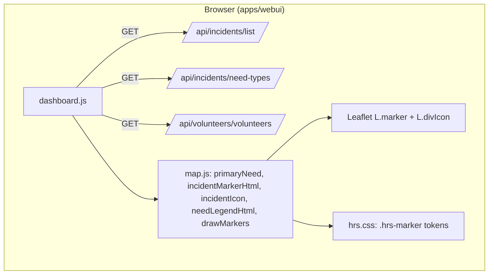

# Specification: Need-type icons on the incident map

**Status:** Draft (awaiting `/plan`)

## Executive Summary

Replace the plain status-coloured circles on the dashboard map with icon markers that show each
incident's main need (rescue, medical, food, …) in its colour, with the validation status as the
ring, a "+N" count for extra needs and a red badge for life-threatening incidents. A legend
explains the icons. Icons and colours come from the admin-editable need types added in #75.

---

## Problem Statement

**Current State:**
- Incidents are `L.circleMarker`s coloured only by validation status.
- Needs, life-threatening and people count exist in the API but aren't shown on the map.

**Desired State:**
- Operators can tell what help is needed, and which incidents are life-threatening, from the map.

**Impact:**
- Faster triage; the map becomes useful for any hazard because needs are hazard-agnostic.

---

## Goals & Success Criteria

### Primary Goals
1. Show the main need as the marker icon and colour.
2. Keep validation status visible (ring) and make life-threatening incidents stand out.
3. Explain the icons with a legend.

### Success Criteria
- [ ] Acceptance criteria in `planning/requirements.md` are met.
- [ ] Vitest tests for marker building, fallback, escaping and drawing pass.
- [ ] Manually checked in the browser in light and dark themes.

### Non-Goals
- Map filters, editing needs, clustering, volunteer skill icons, Bangla UI.

---

## Architecture Overview

### High-Level System Architecture

---

## Technical Design

### Django Backend
- Models: none (uses `NeedType` from #75).
- Views/APIs: none; reuses `IncidentListView` and `NeedTypeListView`.
- URLs: none.
- Celery Tasks: none.

### Web dashboard (`apps/webui`)
- `constants.js`: `API.needTypes`.
- `map.js`: pure helpers (to be detailed in `/plan`).
- `dashboard.js`: load need types with the other data; render legend; pass need types to
  `drawMarkers`.
- `hrs.css`: marker component using design tokens.
- `dashboard.html`: legend container in the map card footer.

---

## Data Model Changes

None.

---

## API Specification

### Endpoint Overview
No new or changed endpoints. Consumed: `GET /api/incidents/list/` (`needs`, `life_threatening`,
`people_count`), `GET /api/incidents/need-types/` (`code`, `label_en`, `icon`, `colour`,
`is_fallback`, ordered by `sort_order`).

---

## Testing Strategy

To be completed in `/plan` (test-first).

### Unit Tests
- Vitest: `apps/webui/static/webui/js/map.test.js`.

### Integration Tests
- 

### E2E Tests
- Manual browser check.

---

## Migration Plan

### Phase 1
- Ship with the dashboard; no data migration.

---

## Security Considerations

- Admin-editable icon names and colours are validated (`[a-z0-9-]+`, `#RRGGBB`) before going into
  HTML/CSS; labels are escaped.

---

## Performance Considerations

- One extra GET on load; `divIcon` markers; check 500 incidents stay smooth.

---

## Summary

A frontend-only change that turns need types into map icons, keeping status and urgency visible.
