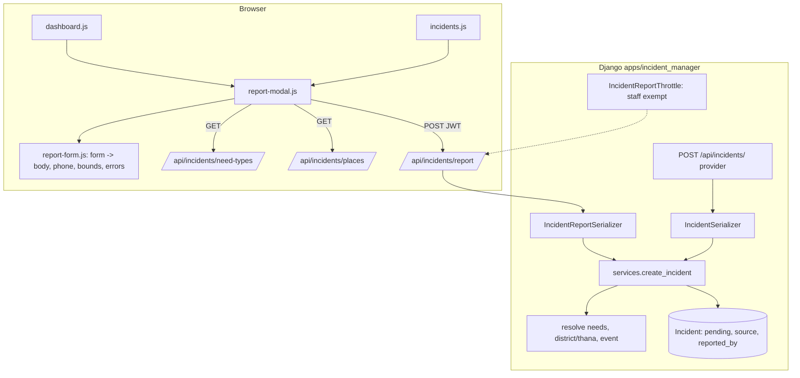
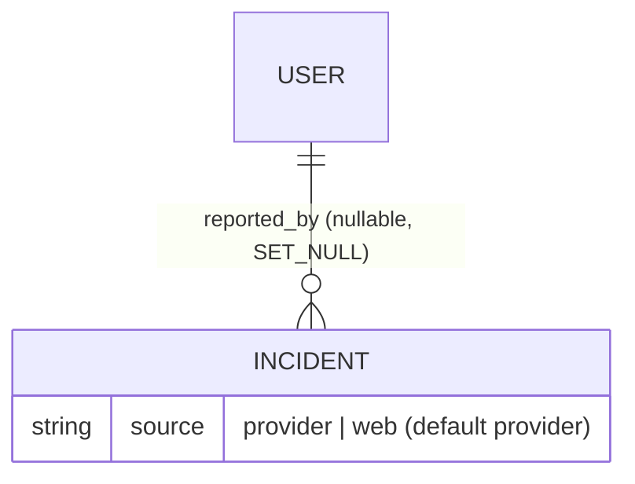

# Specification: Report an incident from the web app for staff review

**Status:** Implemented and tested

## Executive Summary

Anyone with an account can report an incident from the web app. A "Report incident" button on the
dashboard and the Incidents page opens a pop-up form (message, needs, urgency, people, contact,
district/thana, address, map location). A new signed-in API creates the incident as **pending**
with `source = web` and `reported_by`, using the same needs/place/event logic as provider reports.
Staff review it with the existing validate/reject actions. Non-operators get a report panel instead
of the access notice, and are rate-limited. The provider API also stops accepting
`validation_status`, so every new incident waits for review.

---

## Problem Statement

**Current State:**
- Only API-key providers create incidents; web users can't report.
- Incidents don't record a reporter or source.
- Providers can create already-validated incidents (status is writable).
- Need types are operator-only; there is no district/thana lookup API.

**Desired State:**
- Any account can report from the web; every new incident is pending until staff review it;
  operators see where it came from and who sent it.

**Impact:**
- Phone-call and field reports enter the same triage flow; review can't be skipped.

---

## Goals & Success Criteria

### Primary Goals
1. Signed-in report API: pending forced, reporter and source recorded, rate-limited for
   non-operators, shared creation logic with providers.
2. Report pop-up on the dashboard and Incidents page with map/GPS location and validation.
3. Operators see web reports (badge, reporter); providers can no longer skip review.

### Success Criteria
- [x] Acceptance criteria in `planning/requirements.md` met.
- [x] Every test under Testing Strategy written first, watched fail, passing.
- [x] Browser-checked as operator and non-operator, desktop and phone, light and dark.

### Non-Goals
- Anonymous reporting, attachments, "My reports", SMS confirmation, loading boundary shapes.

---

## Decisions (from planning)

| Topic | Decision |
|-------|----------|
| Who can report | Anyone with an account |
| Form | Bootstrap pop-up (full screen on phones), opened from page headers |
| Location | Required: tap map (drag pin) or "Use my location"; inside Bangladesh |
| District/thana | Dropdowns (optional) → SMS keyword names → point-in-polygon from the pin → empty |
| Reporter/source | `Incident.reported_by` (FK, SET_NULL) + `Incident.source` (`provider`/`web`) |
| Rate limit | Non-operators 10/hour per account; operators exempt |
| Providers | `validation_status` read-only on create: always pending |
| Contact | Required, pre-filled from profile phone, BD mobile validated and normalised |
| Non-operators | Report panel + button instead of the access notice; no incident data |

---

## Architecture Overview

---

## Technical Design

### Django Backend

**Model (`apps/incident_manager/models/incident.py`)** + migration `0011_incident_source_reported_by`:
- `reported_by = ForeignKey(settings.AUTH_USER_MODEL, null=True, blank=True, on_delete=SET_NULL,
  related_name="reported_incidents")`
- `source = CharField(max_length=16, choices=IncidentSource.choices(), default="provider",
  db_index=True)`; `IncidentSource` enum (`provider`, `web`) in `constants.py`. Existing rows get
  `provider` from the default.

**Service (`apps/incident_manager/services/incidents.py`, new)** —
`create_incident(*, description, address, contact_number, location, needs=None,
life_threatening=False, people_count=None, district=None, thana=None, source, reported_by=None,
provider=None, additional_info=None) -> Incident`:
- parse the report (`parse_report`); needs = explicit or parsed codes (fallback need);
- district/thana = explicit → parsed names (`iexact`) → `District/Thana.objects.filter(
  polygon__contains=location)` → None;
- `validation_status` always pending; `attach_event(incident)`.
- `IncidentSerializer.create` (provider) is refactored onto it (existing tests stay green).

**Provider serializer:** `validation_status` moved to `read_only_fields` (ignored on create).

**Report serializer (`IncidentReportSerializer`)**: `description` (≤2000), `needs` (codes,
optional), `life_threatening`, `people_count` (≥0), `contact_number`, `latitude`/`longitude`
(required, inside Bangladesh: lat 20.3–26.8, lon 87.9–92.8), `address` (≤255), `district`
(id, optional), `thana` (id, optional; must belong to `district` when both are given).
`validate_contact_number`: strip spaces/dashes, accept `01XXXXXXXXX`, `8801XXXXXXXXX`,
`+8801XXXXXXXXX` (operator digit 3–9), store `01XXXXXXXXX`.
Response `{id, validation_status, created_at}` (no other people's data).

**Views (`apis.py`):**
- `IncidentReportView(CreateAPIView)`: `IsAuthenticated`, `JWTAuthentication`/session,
  `throttle_classes=[IncidentReportThrottle]`; `perform_create` passes `source="web"`,
  `reported_by=request.user`.
- `IncidentReportThrottle(UserRateThrottle)`: `scope = "incident_report"`; `allow_request` returns
  True for staff. `REST_FRAMEWORK["DEFAULT_THROTTLE_RATES"]["incident_report"] = "10/hour"`
  (env-overridable). Cache: default local-memory cache is fine per process; note in docs.
- `PlaceListView`: `IsAuthenticated`; districts (by name) with nested thanas (id, name), one
  `prefetch_related("thanas")` query pair.
- `NeedTypeListView`: `IsAdminUser` → `IsAuthenticated`.

**Serializers for operators:** `IncidentListSerializer` + `source`; `IncidentDetailSerializer` +
`reported_by` (`{id, name}`, name = full_name or username, or null).

**URLs:** `report/` → `incident-report`; `places/` → `place-list`.

**Admin:** `source` and `reported_by` in `IncidentAdmin` list_display/list_filter (read-only).

**Celery/signals:** unchanged (SMS task fires on validation only).

### Web dashboard (`apps/webui`)

**`report-form.js`** (new, pure):
- `normalisePhone(text)` → `01XXXXXXXXX` or null.
- `insideBangladesh(lat, lng)`.
- `readReportForm(form, { location })` → `{ body, errors }` (client checks: message, address,
  location, phone, people count, thana requires matching district).
- `thanaOptions(places, districtId, selected)`, `districtOptions(places, selected)`.
- `reportFormHtml(needTypes, places, { phone })`.
- `reportSuccessText(id)`.

**`report-modal.js`** (new): `createReportModal({ L, Modal, element, loadLookups, submit,
onCreated, getUser })` — lazily loads need types + places on first open, renders the form,
pre-fills the profile phone, map (Bangladesh view) with click-to-place and draggable pin, "Use my
location" via `navigator.geolocation` (errors shown inline), submit → `apiPost`, maps 400 errors
with `showFieldErrors` (reused from `incident-views.js`), 429 → form-level message, success →
close + toast + `onCreated(id)`. Keeps focus management (first invalid field).

**Templates:** `components/report_modal.html` (pop-up markup) included by `dashboard.html` and
`incidents.html`; a "Report incident" button in both page headers; Leaflet on both pages.

**`dashboard.js` / `incidents.js`:** wire the modal; on 403 render `reportPanelHtml()` (new, in
`tables.js`, replacing `operatorAccessNotice` for these pages) with its own Report button;
after creation operators reload data (dashboard: summary + markers; incidents: current page).

**`incident-views.js`:** "Web" badge in rows/cards when `source === 'web'`; details "Source" shows
"Web · reported by <name>" or the provider name.

**CSS:** `.hrs-report-map` (240px; 50vh on phones), crosshair cursor; `.hrs-report-panel`.

**Docs:** `docs/development.md` (report API, places API, need-types access, rate limit, provider
status change), `docs/design-system.md` (report panel, badge).

---

## Data Model Changes

---

## API Specification

| Method | Endpoint | Who | Change |
|--------|----------|-----|--------|
| POST | `/api/incidents/report/` | Any signed-in user (non-staff 10/hour) | **New.** Body: `description`, `address`, `contact_number`, `latitude`, `longitude`, optional `needs`, `life_threatening`, `people_count`, `district`, `thana`. Always pending. `201 {id, validation_status, created_at}`; 400 field errors; 429 when limited |
| GET | `/api/incidents/places/` | Any signed-in user | **New.** `[{id, name, thanas: [{id, name}]}]` |
| GET | `/api/incidents/need-types/` | Any signed-in user | Was operators only |
| POST | `/api/incidents/` | Provider API key | `validation_status` ignored (always pending) |
| GET | `/api/incidents/list/`, `/api/incidents/<id>/` | Operators | + `source`; detail + `reported_by` |

---

## Testing Strategy

Every test is written **before** the code it covers, watched fail for the expected reason, then
made to pass. Django in Docker; Vitest on the host. No external services (Celery `.delay` patched).

### Django: `apps/incident_manager/tests/test_incident_report_api.py` (new)
| Test | Proves |
|------|--------|
| a signed-in user who is not an operator can report an incident and it is pending | FR1, FR6 |
| the report records the reporter and the web source | FR6, FR11 |
| a status sent by the reporter is ignored | FR6, review can't be skipped |
| anonymous requests cannot report | security |
| the report keeps needs, life-threatening, people count, address and location | FR3, FR6 |
| without needs, SMS keywords in the message decide them, else the fallback need | FR3, FR6 |
| a chosen district and thana are used | FR7 |
| a thana that is not in the chosen district is rejected | FR7 |
| without a choice, the district and thana whose boundaries contain the pin are used | FR7 |
| the report is attached to the active event covering its district | FR6 |
| the contact number is required and must be a Bangladeshi mobile number | FR3 |
| +880 and 880 numbers are stored as 01 numbers | FR3 |
| a location outside Bangladesh or missing is rejected | FR3 |
| the message and address are required and length-limited | FR3 |
| an unknown need code is rejected | FR3 |
| a negative people count is rejected | FR3 |
| the response gives only the id, status and time | privacy |
| non-operators are limited to 10 reports an hour | FR8 |
| operators are not rate limited | FR8 |
| reporting does not queue the SMS task | review first |

### Django: other test files
| File | Test | Proves |
|------|------|--------|
| `test_incident_model_source.py` (new) | existing and provider incidents have the provider source and no reporter | FR11 |
| `test_create_incidents.py` | a provider cannot create an already validated incident | FR13 |
| `test_create_incidents.py` | (existing provider tests stay green after the service refactor) | regression |
| `test_places_api.py` (new) | signed-in users get districts with their thanas, by name | FR9 |
| `test_places_api.py` | anonymous users cannot list places | security |
| `test_places_api.py` | listing places takes a constant number of queries | performance |
| `test_need_types.py` | any signed-in user can list need types; anonymous cannot | FR10 |
| `test_incident_list_filters.py` / `test_incident_detail_api.py` | operators see the source in the list and the reporter's name in the details | FR12 |

### Vitest: `report-form.test.js` (new)
| Test | Proves |
|------|--------|
| normalises Bangladeshi mobile numbers and rejects anything else | FR3 |
| knows whether a point is inside Bangladesh | FR3 |
| reads the form into a request body with the chosen needs, place and location | FR3, FR6 |
| reports missing message, address, location and contact before sending | FR4 |
| rejects a negative or fractional people count | FR4 |
| lists only the chosen district's thanas | FR3 |
| pre-fills the contact number from the profile phone | FR3 |
| escapes need, district and thana names | security |

### Vitest: other
| File | Test | Proves |
|------|------|--------|
| `tables.test.js` | the report panel invites non-operators to report and explains operator access | FR2 |
| `incident-views.test.js` | web reports show a Web badge in rows and cards | FR12 |
| `incident-views.test.js` | the details name the reporter of a web report, or the provider | FR12 |

### Test files and results
- Django: `test_incident_report_api.py` (23), `test_incident_service.py` (1), `test_places_api.py` (3),
  `test_incident_model_source.py` (1), plus additions to `test_create_incidents.py`,
  `test_need_types.py`, `test_incident_detail_api.py`.
- Vitest: `report-form.test.js` (10), plus additions to `tables.test.js`, `incident-views.test.js`,
  `map.test.js`. Results and the mutation check are in `tasks.md`.

### Manual (browser, headless Chromium)
- Operator and non-operator (`viewer1`), desktop 1280 and phone 375, light/dark: Report button on
  both pages; non-operator panel; open form, need chips, district → thana filter, map tap + drag,
  "Use my location" (granted with a fake position, and denied); client and server errors; submit →
  toast with #id; operator sees it pending at the top with Web badge; details show reporter;
  validate/reject; 11th report as non-operator → 429 message. Test data removed afterwards.

---

## Migration Plan

### Phase 1
- `0011_incident_source_reported_by`: add fields; existing rows default to `provider`.
- Deploy backend and webui together. Providers that sent `validation_status` now get pending
  incidents (documented).

---

## Security Considerations

- Report API: authenticated only, status forced pending server-side, strict validation, per-user
  throttle for non-staff; the response leaks no other data. Non-operators still can't list or read
  incidents.
- Need types and places become readable by any signed-in user (labels only, no personal data).
- Provider status hole closed.
- All UI text escaped; DB icons/colours via `safeIcon`/`safeColour`.

---

## Performance Considerations

- Report: one INSERT plus small lookups; point-in-polygon only when no district/thana was found
  (indexed geometry once shapes exist).
- Places API: two queries (districts + prefetched thanas); loaded once per page when the form
  first opens.

---

## Summary

One shared creation path, a signed-in report API that always waits for staff review, and a
report pop-up for everyone on the dashboard and Incidents page.
