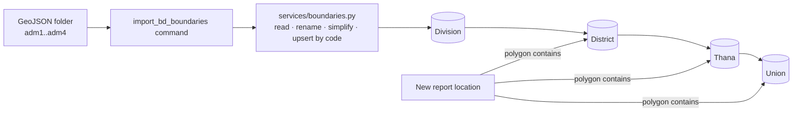
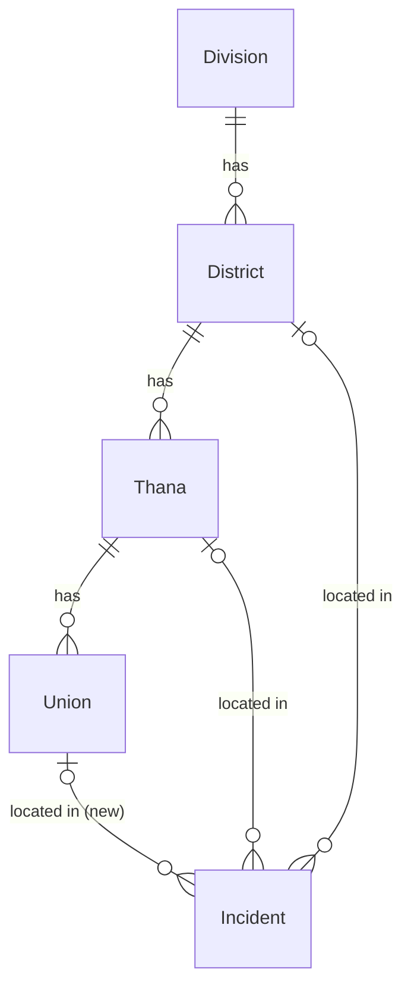

# Specification: Bangladesh administrative boundaries

**Status:** Implemented and tested (2026-11-05) — Django 260, Vitest 173, all passing

## Executive Summary

Load Bangladesh's full administrative hierarchy (8 divisions, 64 districts, 544 upazilas/thanas,
5,160 unions) with boundaries from the OCHA/BBS dataset through a repeatable management command,
add the Union level, and replace the country-wide unique-name rule with uniqueness per parent plus
a national area code (P-code). The dashboard's area filters become complete, and new reports get
their district, thana and union from their location.

---

## Problem Statement

**Current State:**
- One division (Chattogram), one district (Feni), one thana (Parshuram); no boundaries or centres.
- `name` is `unique=True` on Division, District and Thana (since the first model commit `b5f4190`,
  Aug 2024, no recorded reason). Real data has 13 repeated upazila names (Kaliganj ×4, Kotwali ×3…)
  and 423 repeated union names, so it cannot be loaded.
- No Union model.
- Area assignment by location (`services/incidents.py:25-27`) never matches anything.

**Desired State:**
- Full hierarchy with boundaries, loaded and refreshed by `manage.py import_bd_boundaries <folder>`.
- Names unique per parent (case-insensitive); a nationally unique `code` on every level.
- New reports placed in their district, thana and union automatically.

**Impact:**
- Operators can filter by any area; fewer manual edits; volunteer matching by area becomes useful.

---

## Decisions (from planning interview, 2026-11-05)

| Topic | Decision |
|---|---|
| Union scope | **Store + auto-assign**: Union model, imported; new incidents get a union from their location; shown in incident details. Volunteers, dashboard filters and the Location tab stay at district/thana. |
| Spellings | **Official names**: a small map turns old spellings into current ones (Chittagong→Chattogram, Comilla→Cumilla, Jessore→Jashore, Barisal→Barishal, Bogra→Bogura), as whole words at every level (e.g. "Comilla Sadar Dakshin" → "Cumilla Sadar Dakshin"). The same map lets SMS reports using old spellings find their district/thana. |
| Shape detail | **Full files, lightly simplified** on import (tolerance 0.0001° ≈ 11 m, topology preserved), keeping small islands. |
| Data source | **Path argument** only: `import_bd_boundaries <folder>`; no network code. On a server, upload the folder once (scp). |
| Backfill | **None**: existing incidents/volunteers are not changed; only new reports get areas automatically. |
| Area code required? | No: `code` is nullable so operators can still add places by hand in the Location tab; the import fills it. |

---

## Goals & Success Criteria

### Primary Goals
1. Correct uniqueness rules and area codes on every level.
2. Union level, assigned to new incidents by location.
3. Idempotent import of the OCHA/BBS GeoJSON files.

### Success Criteria
- [x] After importing `.local/Bangladesh_GeoJSON`: 8 / 64 / 544 / 5,160 rows, every one with a polygon, a centre and a code
- [x] Same name accepted under different parents; rejected (400 in the API, constraint in the DB) twice under one parent, ignoring case
- [x] Existing Chattogram, Feni and Parshuram rows keep their ids, links and incidents; re-running the import creates nothing new
- [x] A report with only a location gets district, thana and union; a point on St. Martin's Island lands in Teknaf
- [x] An SMS naming "Comilla" finds Cumilla
- [x] Incident details show the union
- [x] All tests written first and passing; full Django and Vitest suites green

### Non-Goals
- Upazilas created after the data (Lalmai, Guimara, Eidgaon, Dasar, Madhyanagar)
- Union filters, union dropdowns, unions on volunteers, unions in the Location tab
- Backfilling existing records
- Bangla names; city-corporation wards; downloading data from the internet

---

## Architecture Overview

---

## Technical Design

### Models (`apps/incident_manager/models/address.py`)
- `Division`: `name` stays unique; add `code = CharField(max_length=16, unique=True, null=True, blank=True)`.
- `District`: drop `unique=True` on `name`; add `code`; `UniqueConstraint(Lower("name"), "division", name="unique_district_name_per_division")`.
- `Thana`: drop `unique=True`; add `code`; `UniqueConstraint(Lower("name"), "district", name="unique_thana_name_per_district")`.
- **New** `Union`: `name`, `code`, `thana` (FK, `related_name="unions"`, CASCADE like the other levels), `polygon`, `center`, `description`; `UniqueConstraint(Lower("name"), "thana", name="unique_union_name_per_thana")`; `__str__` = name.
- `Incident.union`: FK to Union, `null=True, blank=True, on_delete=SET_NULL, related_name="incidents"`.
- Admin: register Union (list: name, thana, code; search name/code; `raw_id_fields` thana).

### Migration (`0013_admin_boundaries`)
Add `code` fields, create `Union`, add `Incident.union`, remove the `unique=True` rules on names, add
the three constraints. Existing data has no duplicates, so it applies cleanly. No data migration.

### Import service (`apps/incident_manager/services/boundaries.py`) and command
- `OFFICIAL_NAMES` + `official_name(name)`: whole-word replacement of the five old spellings.
- Finds `*adm1*.json`, `*adm2*.json`, `*adm3*.json`, `*adm4*.json` directly in the folder (ignores
  `small/` and `admALL` files). Missing level file → `CommandError` naming it.
- Reads features with GDAL `DataSource` (feature by feature, so the 319 MB unions file isn't loaded
  into Python memory at once). Per feature: geometry → `MultiPolygon` (SRID 4326), `simplify(0.0001,
  preserve_topology=True)`, `make_valid()` if needed; `center = point_on_surface` (always inside the area).
- Upsert level by level, parents first: match on `code`; else on (parent, name, ignoring case) to
  adopt hand-added rows (sets their code, keeps id); else create. Updates name/polygon/center.
  Unknown parent code → error, whole import rolled back (one transaction).
- Unions in batches (`bulk_create`/`bulk_update`, batch 500).
- Command: `python manage.py import_bd_boundaries <folder>` prints created/updated per level.

### Area assignment (`apps/incident_manager/services/incidents.py`)
- District/thana by SMS name use `official_name()` so old spellings match.
- New: `union` from `Union.objects.filter(polygon__contains=location)`, restricted to the incident's
  thana when known. `create_incident` stores it.

### API and UI
- Place management serializers (`places_manage.py`): District and Thana validate "name already used
  in this division/district" (case-insensitive) → 400 `{"name": [...]}` instead of a DB error; they
  return `code` read-only.
- Incident detail/list serializer: `union` (name, read-only).
- `incident-views.js`: union joins thana and district in the place line of incident details (escaped).
- Location page: attribution line "Boundaries: OCHA / Bangladesh Bureau of Statistics (CC BY-IGO)".
- `docs/development.md`: how to load boundaries; attribution.

---

## Data Model Changes

---

## API Specification

| Endpoint | Change |
|---|---|
| `POST/PATCH places/manage/districts/` | name unique per division (case-insensitive); `code` in responses |
| `POST/PATCH places/manage/thanas/` | name unique per district (case-insensitive); `code` in responses |
| `GET incidents/`, `GET incidents/<id>/` | new `union` field (name or null) |

No new endpoints.

---

## Testing Strategy (all written before the code they cover)

### Unit / model — `tests/test_admin_boundary_models.py`
- `test_the_same_thana_name_is_allowed_in_two_districts`
- `test_one_district_cannot_have_two_thanas_with_the_same_name_ignoring_case`
- `test_the_same_district_name_is_rejected_twice_in_one_division`
- `test_the_same_union_name_is_allowed_in_two_thanas_but_not_twice_in_one`
- `test_area_codes_are_unique_across_the_country`
- `test_places_added_by_hand_need_no_area_code`
- `test_deleting_a_union_keeps_its_incidents_without_a_union`

### Import — `tests/test_import_bd_boundaries.py` (tiny GeoJSON files written to a temp folder)
- `test_the_import_builds_divisions_districts_thanas_and_unions_from_area_codes`
- `test_old_spellings_become_the_official_ones_as_whole_words`, `test_other_names_and_words_that_merely_contain_an_old_spelling_are_left_alone` (and the hierarchy test checks Chittagong → Chattogram)
- `test_running_the_import_twice_creates_no_duplicates_and_updates_shapes`
- `test_the_import_adopts_places_added_by_hand_and_keeps_their_ids_and_incidents`
- `test_every_imported_area_gets_a_centre_inside_it`
- `test_the_import_simplifies_shapes_but_keeps_small_islands`
- `test_single_polygons_are_stored_as_multipolygons`
- `test_a_folder_missing_a_level_file_is_rejected_with_its_name`
- `test_an_unknown_parent_code_stops_the_import_without_saving_anything`
- `test_the_command_reports_created_and_updated_counts_per_level`
- `test_the_command_turns_import_problems_into_command_errors`

### Area assignment — `tests/test_incident_service.py`
- `test_a_report_with_only_a_location_gets_its_district_thana_and_union`
- `test_the_union_comes_from_the_reports_own_thana_when_it_is_known`
- `test_a_report_outside_every_boundary_gets_no_area`
- `test_a_report_without_a_location_gets_no_union`
- `test_an_sms_using_an_old_district_spelling_finds_the_district`

### API — `tests/test_place_management_api.py`, `tests/test_incident_detail_api.py`
- `test_an_operator_can_add_a_thana_whose_name_exists_in_another_district`
- `test_adding_the_same_thana_name_twice_to_one_district_is_a_name_error_not_a_crash`
- `test_place_rows_and_details_show_their_area_code`
- `test_incident_details_and_list_include_the_union_name`
- existing `test_creating_a_district_needs_a_division_and_a_unique_name` keeps passing (same division)
- `apps/webui/tests/test_pages.py`: `test_the_location_page_credits_the_boundary_data`

### Web (Vitest) — `incident-views.test.js`
- `incident details list the union with the thana and district, escaped, and leave it out when unknown`

### Test files
`apps/incident_manager/tests/test_admin_boundary_models.py`, `test_import_bd_boundaries.py`,
`test_incident_service.py`, `test_place_management_api.py`, `test_incident_detail_api.py`;
`apps/webui/tests/test_pages.py`; `apps/webui/static/webui/js/incident-views.test.js`.

### Mutation check (2026-11-05)
12 deliberate breakages, all caught after strengthening two tests (overlapping unions created in an
order only the thana filter resolves; a C-shaped union whose centroid lies outside it).

### Real-data check (manual, recorded in tasks.md)
Run the command on `.local/Bangladesh_GeoJSON` in Docker: counts 8/64/544/5,160, all with polygons,
centres and codes; Chattogram/Feni/Parshuram ids unchanged; second run creates 0; a point on St.
Martin's Island (20.627, 92.322) resolves to Teknaf; record run time, memory and DB size.

---

## Migration Plan

1. Migration `0013` (schema only).
2. Deploy, then `python manage.py import_bd_boundaries <folder>` once per environment.
3. Re-run any time a newer dataset arrives (updates by code).

---

## Security Considerations
- Import is server-side only (management command); place management stays operator-only.
- Data files are never committed (`.local/` gitignored; files exceed GitHub limits).
- Attribution required by CC BY-IGO.

---

## Performance Considerations
- GeoDjango adds a GiST index on every `polygon` field; `polygon__contains` stays fast.
- Simplification cuts stored points; list views keep deferring `polygon`.
- Feature-by-feature reading keeps import memory bounded; unions saved in batches.
- Simplifying each area on its own can leave ~10 m slivers between neighbours; a point there gets
  no union/thana (acceptable; district usually still matches).

---

## Summary

Full Bangladesh admin hierarchy with boundaries, per-parent name rules, area codes, a Union level
assigned to new reports, and a repeatable import command.
