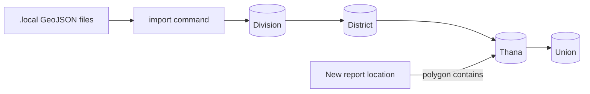

# Specification: Bangladesh administrative boundaries

**Status:** Draft (to be completed by `/plan bd-admin-boundaries`)

## Executive Summary

Load Bangladesh's full administrative hierarchy (8 divisions, 64 districts, 544 upazilas/thanas,
5,160 unions) with boundaries from the OCHA/BBS dataset, add the Union level, and replace the
country-wide unique-name rule with uniqueness per parent plus a national area code. This makes
the dashboard's area filters complete and lets new reports get their area from their location.

---

## Problem Statement

**Current State:**
- One division, district and thana in the DB; no boundary shapes or centre points.
- `name` is `unique=True` on Division, District and Thana (since the first model commit, no recorded reason).
- No Union model.
- Area assignment by location (`services/incidents.py:25-27`) never matches anything.

**Desired State:**
- Full hierarchy with boundaries, loaded by a repeatable import command.
- Names unique per parent; a unique `code` (P-code) per area.
- New reports are placed in their district, thana and union automatically.

**Impact:**
- Operators can filter by any area; volunteers can be matched by area; fewer manual edits.

---

## Goals & Success Criteria

### Primary Goals
1. Correct uniqueness rules and area codes on every level.
2. Union level added.
3. Idempotent import of the OCHA/BBS GeoJSON files.

### Success Criteria
- [ ] Counts 8 / 64 / 544 / 5,160 after import, all with polygons and centres
- [ ] Duplicate names accepted across parents, rejected within one parent
- [ ] Existing rows and links preserved; re-import creates no duplicates
- [ ] Location-only report gets district, thana and union

### Non-Goals
- Newer upazilas missing from the 2015/2020 dataset
- Bangla names, city-corporation wards

---

## Architecture Overview

---

## Technical Design

### Django Backend
- Models: `code` field on Division/District/Thana; `UniqueConstraint` per parent; new `Union`.
- Views/APIs: place management validation per parent; options endpoints include unions (TBD in /plan).
- URLs: TBD in /plan.
- Celery Tasks: none.
- Management command: import boundaries (details TBD in /plan).

---

## Data Model Changes

TBD in `/plan` (migration for constraints, `code`, `Union`, optional `Incident.union`).

---

## API Specification

TBD in `/plan`.

---

## Testing Strategy

TBD in `/plan` (test-first for every task).

---

## Migration Plan

TBD in `/plan`.

---

## Security Considerations

- Import runs server-side only; place management stays operator-only.
- Data files are never committed.

---

## Performance Considerations

- Full-detail polygons for lookups (GiST index); simplified copy for drawing (TBD in /plan).

---

## Summary

Full Bangladesh admin hierarchy with boundaries, per-parent name rules, area codes and a Union level.
